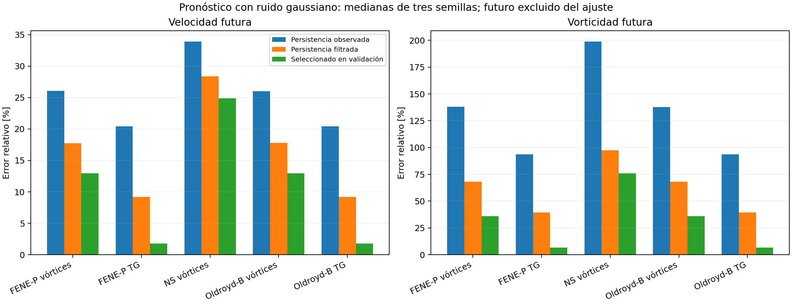
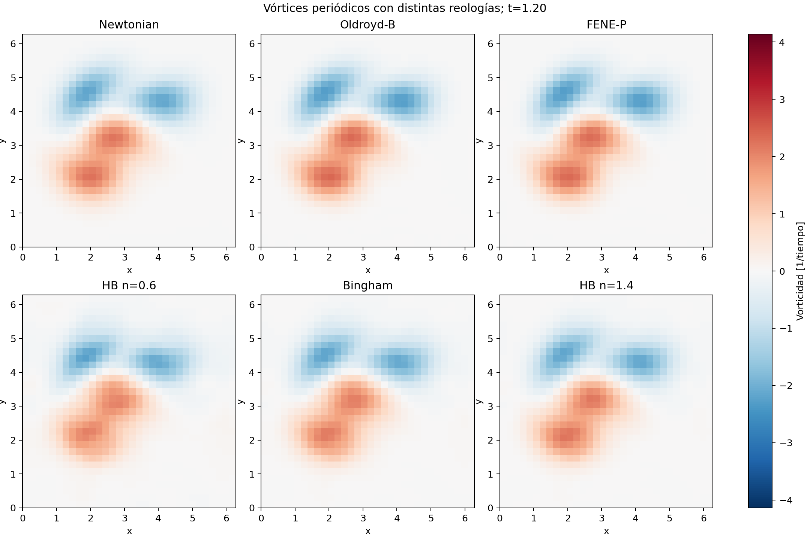

# Ampliación integrada y ejecutada en reissued

Se ejecutaron **2808 condiciones y 8424 ajustes** de reconstrucción, más **60 escenarios de pronóstico** con 29 opciones predeclaradas por escenario. La reconstrucción registró 0 fallos numéricos, 6 condiciones no convergidas y 430 condiciones que cumplen las tolerancias. El pronóstico registró 0 escenarios fallidos.

## Lo que cambió y lo que muestran los datos

En Taylor–Green gaussiano, TLS-DMD de rango 4 tiene error mediano de velocidad **3.709%**; con proyección y corte 2/3 baja a **1.684%**. En los tres casos newtonianos y las mismas semillas, los métodos sin proyección aportan 0 condiciones gaussianas aceptadas y los proyectados 12. La banda física es un prior declarado del banco, no un filtro ajustado con el limpio. La proyección no convierte toda reconstrucción en una solución de la ecuación de movimiento.

El dispatcher fbDMD→TLS usó su alternativa explícita en **23 condiciones** por ramas ambiguas o mal condicionamiento. Se conservan los diagnósticos primarios y ambos costos: no se registra como fbDMD puro exitoso.

El modelo seleccionado con validación ruidosa mejora el error futuro de velocidad frente a persistencia sin filtrar en **48/60 escenarios**, y frente a persistencia filtrada en **43/60**. Esto separa el beneficio de filtrado del beneficio dinámico. Se comparan los valores originales del ledger con tolerancia absoluta 1e-10 en el error relativo; quedan 12 y 17 empates, respectivamente. El contador bruto de completion.json conserva 51 mejoras mediante comparación estricta: incluye diferencias de redondeo que aquí se consideran empates. Los casos de vórtices mantienen errores de vorticidad altos: mejorar velocidad no demuestra capacidad de pronóstico fiable de todas las estructuras.

## Comparación reológica con controles comunes

Se generaron seis fluidos con el mismo estado inicial, densidad, dominio, malla y tiempos. Las viscosidades HB se igualan en una tasa de corte declarada; Oldroyd-B/FENE-P comparten constantes nominales de viscosidad. Las diferencias frente al fluido newtoniano son cambios constitutivos simulados, no errores de reconstrucción. Oldroyd-B y FENE-P son cercanos en este régimen; estos ensayos no demuestran discriminación de materiales a partir de velocidad ruidosa.

[Animación](../../results/research/rheology_matched_2026-10-14/vortices_rheology.gif) y [tabla cuantitativa](../../results/research/rheology_matched_2026-10-14/summary.csv).

## Evidencia y límites

- [Reconstrucción: tabla completa](../../results/research/extended_physics_2026-10-14/summary.csv).
- [Pronóstico y persistencia filtrada](../../results/research/forecasting_extended_2026-10-14/comparison_with_filtered_persistence.csv).
- [Revisión científica independiente](SECOND_REVIEW.md).
- [Viscoelasticidad 2D](VISCOELASTIC_2D.md) y [viscoplasticidad 2D](VISCOPLASTIC_2D.md).

Los solvers no se etiquetan como DNS universalmente certificada. La cuadratura de las leyes no polinómicas y los residuos constitutivos de proyección se conservan. El ruido temporal y la deriva de sensor siguen sin estimadores admisibles a los umbrales de reconstrucción: no se eliminan esos casos. No se ejecutaron estelas externas de cilindro EVP, simulaciones 3D, PIV real, GPU ni aprendizaje profundo. Las configuraciones correspondientes siguen como trabajo adicional.
