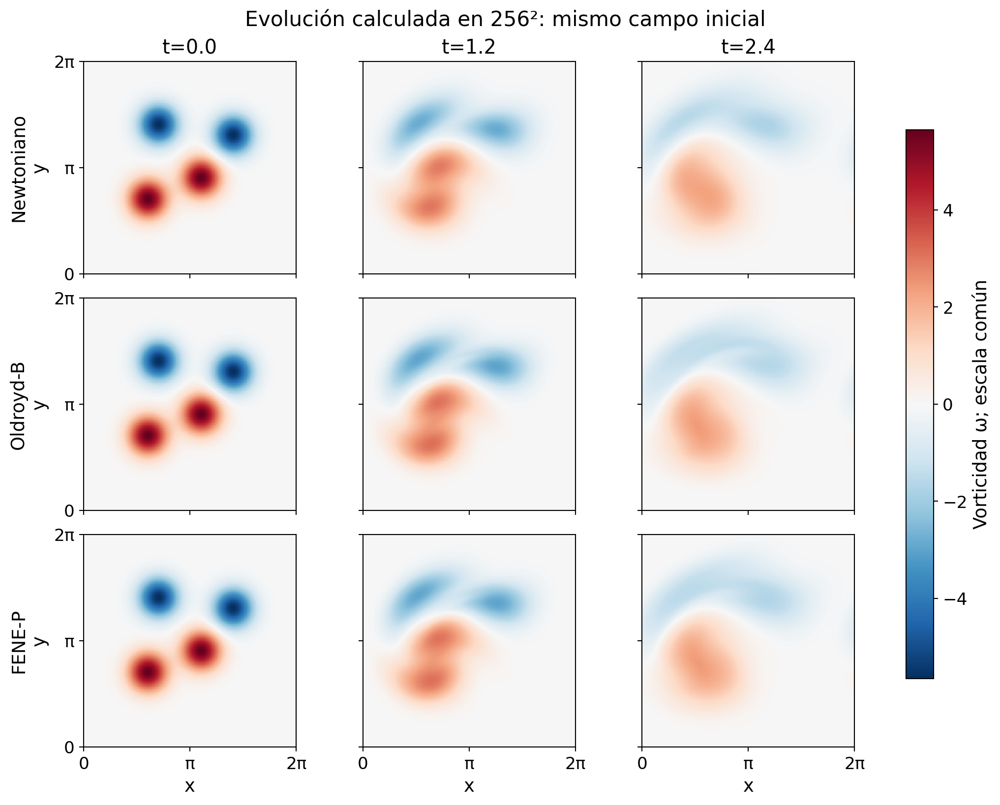
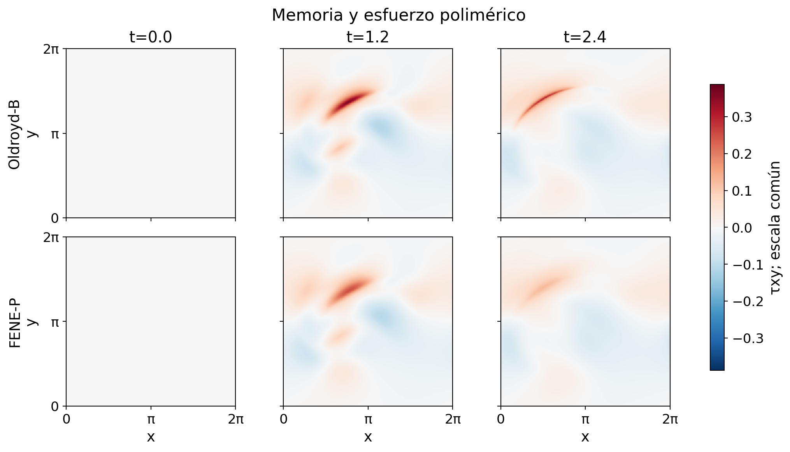
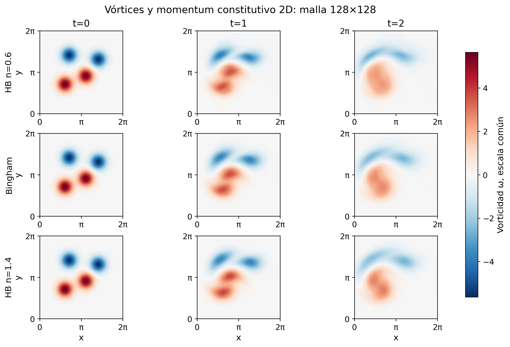
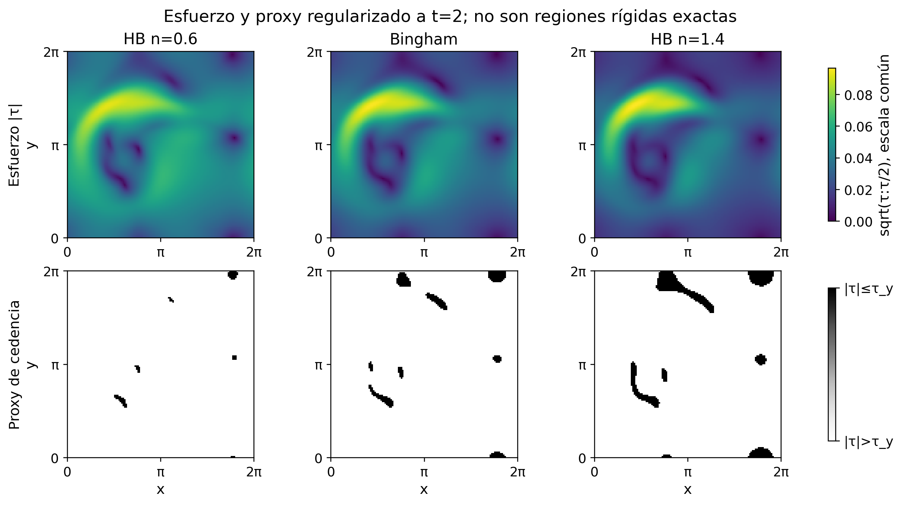
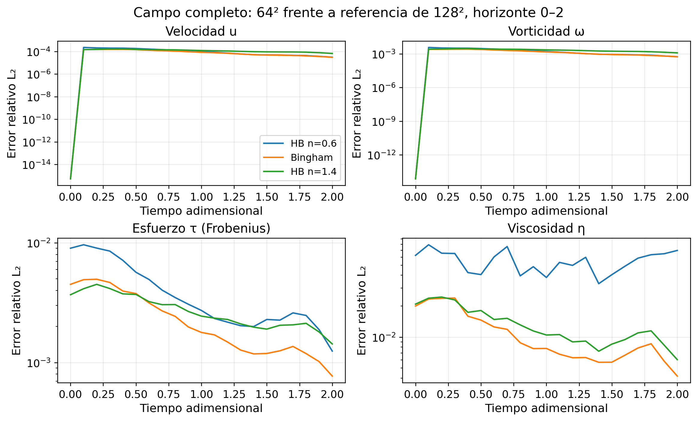
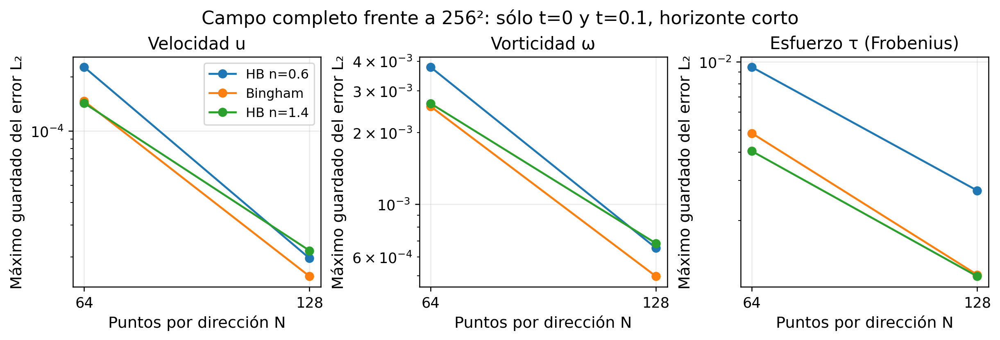

# Mallas ampliadas y evolución física

Documento generado a partir de campañas completas del 14 de octubre de 2026.

Esta ampliación responde a la representatividad de las mallas y permite observar la evolución de los campos. Se integran de nuevo las ecuaciones en mallas mayores: los mapas mostrados proceden de los arrays calculados, sin generar ni completar estructuras mediante ilustración. La interpolación periódica de Fourier se utiliza únicamente para comparar soluciones calculadas por separado. Las campañas anteriores conservan sus resultados y se distinguen de las nuevas condiciones, viscosidades y horizontes.

El corpus completo contiene 8 integraciones espaciales newtonianas, 4 controles temporales newtonianos y 6 controles analíticos; 9 configuraciones viscoelásticas/control newtoniano; 18 configuraciones viscoplásticas; y 60 condiciones adicionales de reconstrucción. Un control analítico no equivale a un nuevo flujo no lineal ni a un ajuste de reconstrucción. Un seguimiento exploratorio posterior añade 24 condiciones con ancho de banda físico fijo; conserva el resultado inicial y se presenta por separado.

Integraciones efectivamente ejecutadas y tiempos adimensionales; las campañas tienen horizontes diferentes.

| Banco | Mallas calculadas | Horizonte | Estados por ejecución |
| --- | --- | --- | --- |
| Navier–Stokes 2D | 64², 128², 256², 512² | 0–4 | 41 |
| Oldroyd-B y FENE-P | 64², 128², 256² | 0–2.4 | 25 |
| HB/Bingham, evolución | 64², 128² | 0–2 | 21 |
| HB/Bingham, referencia corta | 256² | 0–0.1 | 2 |
| Reconstrucción de cuatro vórtices | 128², 256² | 0–4 | 41 |

## Qué representa una malla: error completo, tiempo y espectro

La resolución se juzga contra una ejecución fina del mismo solver, que sigue siendo una referencia numérica. El error en modos comunes compara solamente las escalas compartidas. El error de campo completo prolonga la solución gruesa a la malla fina y compara con la referencia completa sin filtrar; incluye por tanto las estructuras que la malla gruesa omite. En este apartado las tablas espaciales usan el máximo de los errores relativos L2 entre todos los instantes guardados, no el promedio ni solamente el estado final.

El núcleo gaussiano inicial tiene ancho σ=0.065L, con L=2π: 64², 128², 256² y 512² proporcionan 4.16, 8.32, 16.64 y 33.28 celdas por σ. El estado aleatorio inicial newtoniano tiene corte Fourier 8: las mismas mallas tienen 8, 16, 32 y 64 celdas por su menor longitud de onda inicial. Estas cifras describen el estado inicial; los gradientes posteriores requieren sus propios controles. El criterio exploratorio del banco newtoniano exige errores máximos de velocidad y vorticidad menores al 1 %, además de una cola de enstrofía por componente menor que 10⁻⁴. Se declara como diagnóstico de estas condiciones, sin presentarlo como preregistro ciego ni certificado universal de DNS.

Las imágenes mantienen dominio y escalas de color por magnitud dentro de cada comparación. Los bordes opuestos son vecinos periódicos: un vórtice que sale por un borde reaparece por el opuesto. Las flechas y líneas de corriente describen el campo instantáneo, no trayectorias de partículas. Los mapas de error tienen barras propias; el error cero de una referencia frente a sí misma no demuestra exactitud física. Los registros de CPU y tiempo se conservan, pero las ejecuciones compartieron el equipo y sus alcances de medición difieren; no sustentan una comparación precisa de velocidad entre solvers.

## Navier–Stokes: interacción, espectros y referencia 512²

Se estudiaron dos estados no lineales periódicos con ν=0.01, velocidad RMS inicial U=0.8, semilla 17 y horizonte T=4. El número de Reynolds basado en L=2π es 502.7; para el ancho del núcleo es 32.67. Son escalas declaradas, no una clasificación universal del régimen. El nombre del caso «turbulencia en decaimiento» no acredita caos; no se calcula un exponente de Lyapunov.

Errores completos máximos sobre los 41 estados; incluye las escalas no representadas.

| Flujo | Malla | Referencia | Máx. error u | Máx. error ω | Criterio exploratorio |
| --- | --- | --- | --- | --- | --- |
| Cuatro vórtices en interacción | 64² | 512² | 0.02337 % | 0.3626 % | Sí |
| Cuatro vórtices en interacción | 128² | 512² | 2.471e-05 % | 7.410e-04 % | Sí |
| Cuatro vórtices en interacción | 256² | 512² | 4.027e-08 % | 2.671e-07 % | Sí |
| Turbulencia 2D en decaimiento | 64² | 512² | 0.2007 % | 1.312 % | No |
| Turbulencia 2D en decaimiento | 128² | 512² | 0.002455 % | 0.03032 % | Sí |
| Turbulencia 2D en decaimiento | 256² | 512² | 7.525e-08 % | 1.565e-06 % | Sí |

Para cuatro vórtices, 64² ya presenta un máximo de vorticidad de 0.3626 % frente a 512² y cumple el diagnóstico de este caso suave. En cambio, el estado en decaimiento da 1.312 % en 64² y 0.03032 % en 128². El primero falla el nivel del 1 % y la cola espectral exigida. La representatividad depende del flujo y de la cantidad observada; no basta extrapolar la convergencia de un estado a todo el banco.


Cuatro vórtices en interacción en 512²: tres estados calculados en t=0, t=2 y t=4. Vorticidad con signo y rapidez usan escalas constantes por fila; las flechas muestran velocidad instantánea. Se observan deformación e intercambio de estructura en un dominio periódico, no una estela externa. La secuencia original de cinco tiempos y la animación completa quedan enlazadas como compañeros.


Cuatro vórtices en interacción: vorticidad final calculada en cuatro mallas y diferencias de campo completo respecto a 512². La fila inferior transfiere cada solución gruesa a la malla fina; su barra de error es distinta de la barra física. El panel 512² se compara consigo mismo y tiene error cero por definición.


Cuatro vórtices en interacción: energía, enstrofía y errores completos de velocidad y vorticidad durante el intervalo. Las curvas permiten localizar máximos anteriores al tiempo final; la tabla de resolución informa los máximos de toda la secuencia. La versión exploratoria añade espectros y marcadores finales.


Cuatro vórtices en interacción en 512²: evolución de energía y enstrofía por anillos de número de onda. La enstrofía pondera gradientes y complementa la inspección de rapidez. Una cola decreciente aporta evidencia para este flujo e intervalo, sin certificar todas las escalas de otros regímenes.


Cuatro vórtices en interacción: energía calculada y energía integrada mediante la disipación viscosa, con defecto normalizado. La integral usa trapecios entre estados guardados; el defecto incluye error de cuadratura temporal de salida y no equivale al error local de los pasos RK4.


Turbulencia 2D en decaimiento en 512²: tres estados calculados en t=0, t=2 y t=4. Vorticidad con signo y rapidez usan escalas constantes por fila; las flechas muestran velocidad instantánea. Se observan deformación e intercambio de estructura en un dominio periódico, no una estela externa. La secuencia original de cinco tiempos y la animación completa quedan enlazadas como compañeros.


Turbulencia 2D en decaimiento: vorticidad final calculada en cuatro mallas y diferencias de campo completo respecto a 512². La fila inferior transfiere cada solución gruesa a la malla fina; su barra de error es distinta de la barra física. El panel 512² se compara consigo mismo y tiene error cero por definición.


Turbulencia 2D en decaimiento: energía, enstrofía y errores completos de velocidad y vorticidad durante el intervalo. Las curvas permiten localizar máximos anteriores al tiempo final; la tabla de resolución informa los máximos de toda la secuencia. La versión exploratoria añade espectros y marcadores finales.


Turbulencia 2D en decaimiento en 512²: evolución de energía y enstrofía por anillos de número de onda. La enstrofía pondera gradientes y complementa la inspección de rapidez. Una cola decreciente aporta evidencia para este flujo e intervalo, sin certificar todas las escalas de otros regímenes.


Turbulencia 2D en decaimiento: energía calculada y energía integrada mediante la disipación viscosa, con defecto normalizado. La integral usa trapecios entre estados guardados; el defecto incluye error de cuadratura temporal de salida y no equivale al error local de los pasos RK4.

Control temporal a malla fija, frente a dt nominal 0.00125; máximos en los tiempos guardados.

| Flujo, 128² | dt nominal | dt máximo real | Máx. error u | Máx. error ω |
| --- | --- | --- | --- | --- |
| Cuatro vórtices en interacción | 0.005 | 0.005 | 1.955e-07 % | 1.201e-06 % |
| Cuatro vórtices en interacción | 0.0025 | 0.0025 | 1.149e-08 % | 7.054e-08 % |
| Turbulencia 2D en decaimiento | 0.005 | 0.005 | 1.600e-07 % | 7.799e-07 % |
| Turbulencia 2D en decaimiento | 0.0025 | 0.0025 | 9.341e-09 % | 4.548e-08 % |

Los solvers aplican límites internos de estabilidad, de modo que el paso nominal puede superar el paso real. Se registran ambos y el número de límites activos. El paso mínimo también puede contener ajustes diminutos para alcanzar exactamente un tiempo de salida; no se interpreta por sí solo como rigidez. El orden RK4 se verifica aparte con Taylor–Green analítico en una malla donde los pasos nominales son realmente distintos, mientras que el control Taylor–Green 128² comprueba la referencia exacta de un único modo y conserva los límites efectivos.

## Viscoelasticidad: la velocidad puede converger antes que el polímero

Oldroyd-B y FENE-P se integraron con U=0.8, ν_s=0.02, ν_p=0.04, λ=0.5, y difusión constitutiva κ=0, hasta T=2.4. FENE-P usa L²=12; Oldroyd-B no tiene un límite de extensibilidad finita. Ambos retienen el tensor C tridimensional en flujo plano. El control newtoniano ν=0.06 tiene la misma velocidad inicial, densidad, dominio, malla fina y tiempos. La diferencia respecto a él representa dinámica constitutiva; no es un error de reconstrucción. El esfuerzo polimérico inicial es cero cuando C=I y no equivale al esfuerzo newtoniano instantáneo.

Máximos de campo completo frente a 256²; C−I evita ocultar la deformación detrás de la identidad.

| Modelo | Malla | Ref. | Máx. error u | Máx. error ω | Máx. error C−I | Máx. error τ |
| --- | --- | --- | --- | --- | --- | --- |
| Oldroyd-B | 64² | 256² | 0.01958 % | 0.3684 % | 12.24 % | 12.24 % |
| Oldroyd-B | 128² | 256² | 8.872e-04 % | 0.03377 % | 4.383 % | 4.383 % |
| FENE-P | 64² | 256² | 0.01214 % | 0.219 % | 0.789 % | 0.8787 % |
| FENE-P | 128² | 256² | 4.738e-04 % | 0.01715 % | 0.101 % | 0.1165 % |

La comparación de C por sí solo puede diluir el error de deformación, porque incluye el tensor identidad. Se evalúa por ello C−I además del esfuerzo τ, usando la norma tensorial de todos sus componentes. En t=0 ambos son nulos y su error relativo es indefinido: ese estado se conserva como null y se excluye del máximo relativo, sin asignarle un cero artificial. Las curvas y errores RMS absolutos permanecen en el JSON. La energía fuera de la banda gruesa se registra por separado del error dinámico.

En 128², Oldroyd-B conserva errores máximos de 4.383 % en C−I y 4.383 % en esfuerzo frente a 256², aunque su velocidad sea mucho más precisa. FENE-P presenta 0.101 % y 0.1165 % en esas mismas cantidades. Aplicar el nivel exploratorio del 1 % también al tensor y al esfuerzo deja la memoria de Oldroyd-B por resolver en 128². La malla 256² se usa como referencia numérica, sin declararla convergida contra una integración viscoelástica aún más fina.

En la propia referencia Oldroyd-B 256², la fracción máxima de potencia tensorial en la cola exterior de la banda retenida es 1.157e-04. Supera marginalmente la heurística 10⁻⁴ y refuerza la interpretación condicionada de esa referencia. Una cola pequeña por sí sola no demuestra convergencia; para establecerla se necesita la comparación tensorial contra una ejecución más fina.



Evolución calculada de vorticidad en 256² para el control newtoniano, Oldroyd-B y FENE-P, en tres tiempos comunes. La escala con signo se mantiene en los nueve paneles. Las líneas de corriente son instantáneas y los límites del dominio son periódicos.


Deformación polimérica tr(C)−3 en Oldroyd-B y FENE-P, en 256² y tres estados calculados. La identidad tridimensional tiene tr(I)=3. El mapa visualiza extensión constitutiva con una escala común por magnitud, sin sustituir la comprobación tensorial completa.



Esfuerzo polimérico cortante τxy en Oldroyd-B y FENE-P, en 256² y tres tiempos comunes. El signo y la barra física se conservan en la secuencia; las bandas de esfuerzo pueden exigir más resolución que un campo de velocidad visualmente suave.


Refinamiento viscoelástico frente a 256²: errores completos durante la evolución para velocidad, vorticidad, C−I y esfuerzo. Las tablas informan el máximo de estas curvas, incluso cuando éste ocurre antes del estado final. El archivo de análisis también conserva las comparaciones de modos comunes.


Espectros viscoelásticos finales de velocidad, deformación y esfuerzo. Los campos constitutivos derivados, especialmente FENE-P, pueden generar frecuencias adicionales aunque C se integre en una banda de Fourier truncada. La inspección del espectro complementa las comparaciones de campo completo.


Intercambio de energía cinética y energía libre del polímero, memoria constitutiva y residuos medidos. Se distinguen el balance del operador semidiscreto, el defecto espacial de proyección y el residuo temporal calculado desde snapshots. Este último incorpora el error de diferenciación entre salidas.

Admisibilidad en etapas internas de la malla fina y balance semidiscreto relativo; no son errores contra limpio.

| Modelo | Wi de referencia | Mín. autovalor C | Máx. tr(C) | Defecto / pico disipación |
| --- | --- | --- | --- | --- |
| Oldroyd-B | 0.9794 | 0.3648 | 14.11 | 0.003405 % |
| FENE-P | 0.9794 | 0.3205 | 6.376 | 3.734e-07 % |

Control temporal separado en 128²: dt nominal 0.004 frente a 0.002, con límites efectivos explícitos.

| Modelo, 128² | dt máximo real | dt máximo real ref. | Máx. error u | Máx. error τ |
| --- | --- | --- | --- | --- |
| Oldroyd-B | 0.004 | 0.002 | 3.130e-08 % | 1.514e-05 % |
| FENE-P | 0.004 | 0.002 | 1.937e-08 % | 1.935e-06 % |

La positividad de C y el límite de traza de FENE-P se comprueban en etapas internas; los pasos que los violan se rechazan y se registra su reducción, sin recortar el tensor. Los residuos constitutivos y energéticos son medidos y pueden ser no nulos. El control dt/2 acota el efecto temporal en 128²; no sustituye el refinamiento espacial ni extiende la conclusión a alto Weissenberg, paredes, cilindros o tridimensionalidad.

## Viscoplasticidad: corte, viscosidad y esfuerzo con horizontes separados

Herschel–Bulkley adelgazante (n=0.6), Bingham (n=1) y Herschel–Bulkley espesante (n=1.4) parten de la misma velocidad de cuatro vórtices, U=0.8. El esfuerzo de cedencia es τ_y=0.01, m=10 y ε=0.001. La consistencia K se ajusta para que la viscosidad aparente sea 0.04 a una tasa declarada γ̇=1.959. Igualar un punto de las curvas no hace equivalentes los materiales en todas las tasas ni iguala automáticamente sus Reynolds. Los modelos son regularizados e inelásticos; sus zonas de bajo esfuerzo siguen admitiendo deformación.

Evolución larga, 0≤t≤2: 64² frente a 128²; máximos completos y norma física del esfuerzo.

| Material | Malla | Máx. error u | Máx. error ω | Máx. error τ | Máx. error η |
| --- | --- | --- | --- | --- | --- |
| Bingham regularizado | 64² | 0.01547 % | 0.2662 % | 0.496 % | 2.399 % |
| HB espesante | 64² | 0.01671 % | 0.3024 % | 0.4498 % | 2.452 % |
| HB adelgazante | 64² | 0.0227 % | 0.3775 % | 0.963 % | 7.906 % |

Referencia corta, 0≤t≤0.1: comparación frente a 256²; máximos completos y norma física del esfuerzo.

| Material | Malla | Máx. error u | Máx. error ω | Máx. error τ | Máx. error η |
| --- | --- | --- | --- | --- | --- |
| Bingham regularizado | 64² | 0.01462 % | 0.2579 % | 0.4848 % | 2.382 % |
| Bingham regularizado | 128² | 0.001559 % | 0.0497 % | 0.1157 % | 0.8218 % |
| HB espesante | 64² | 0.01427 % | 0.2655 % | 0.4043 % | 2.513 % |
| HB espesante | 128² | 0.002165 % | 0.0684 % | 0.114 % | 0.8806 % |
| HB adelgazante | 64² | 0.02261 % | 0.3776 % | 0.946 % | 7.095 % |
| HB adelgazante | 128² | 0.001963 % | 0.06539 % | 0.2714 % | 5.023 % |

La referencia 256² sólo cubre t≤0.1 y contiene dos salidas, t=0 y t=0.1. Su concordancia no valida el horizonte completo hasta t=2. La evolución larga tiene únicamente el control 64²/128² y conserva sus errores de velocidad, vorticidad, tasa de corte, viscosidad y esfuerzo. El esfuerzo simétrico se evalúa con Frobenius, τxx²+2τxy²+τyy²; el comparador primario también conserva la norma del vector empaquetado de tres componentes, que no es idéntica.

La viscosidad aparente HB adelgazante conserva un máximo de diferencia completa 7.906 % en la comparación larga 64²/128², y de 5.023 % en 128² frente a 256² durante el horizonte corto. Los errores pequeños de velocidad y esfuerzo no bastan para declarar convergido ese campo constitutivo. La ley regularizada es especialmente sensible a diferencias de corte cerca de tasas pequeñas.



Evolución real de los tres materiales viscoplásticos en 128²: tres tiempos del horizonte hasta t=2. La escala de vorticidad es común para todos los paneles y revela deformación, desplazamiento y difusión bajo condiciones iniciales iguales.


Tasa de corte y viscosidad aparente finales de los tres materiales en 128². La viscosidad usa una escala logarítmica común declarada; las magnitudes y sus barras se muestran por separado. Son campos constitutivos calculados, sin un tope artificial de viscosidad.



Esfuerzo y proxy de bajo esfuerzo respecto a τ_y al final en 128². El indicador regularizado no identifica regiones rígidas exactamente no cedidas. El modelo admite deformación incluso cuando el esfuerzo queda por debajo del umbral.


Energía, enstrofía, disipación y defecto de balance de los tres materiales durante la evolución 128². El balance emplea cuadratura constitutiva con padding; la cuadratura en la malla de salida puede diferir. Los residuos se conservan en vez de reemplazarlos por conservación exacta.



Errores completos durante 0≤t≤2: 64² frente a 128² en velocidad, vorticidad, esfuerzo tensorial de Frobenius y viscosidad aparente. El máximo temporal puede diferir del error final y revela gradientes constitutivos que la rapidez no permite evaluar.



Refinamiento espacial de horizonte corto: máximos sobre t=0 y t=0.1 de las soluciones 64² y 128² frente al campo completo 256². Estos dos instantes no establecen convergencia a lo largo de la evolución posterior hasta t=2.

HB adelgazante, control temporal a 128² hasta t=0.1; nominales 0.0004/0.0002 frente a 0.0001.

| dt máximo real | dt máximo real ref. | Máx. error u | Máx. error ω |
| --- | --- | --- | --- |
| 4.000e-04 | 1.000e-04 | 3.222e-11 % | 8.043e-10 % |
| 2.000e-04 | 1.000e-04 | 5.504e-12 % | 6.535e-11 % |

La sensibilidad a padding, m y ε se registra en un archivo aparte. Aumentar el padding comprueba la cuadratura de la ley no polinómica; cambiar m o ε modifica la ley constitutiva regularizada. Son preguntas diferentes del refinamiento de malla. El padding 3/2 no elimina exactamente todo el aliasing de esta ley y la ausencia de un tope de viscosidad puede imponer pasos internos pequeños.

## Reconstrucción en 128² y 256²: conservar divergencia no basta

Se ajustaron cinco variantes declaradas (observación, POD r=8, TLS-DMD r=8, TLS-DMD r=8 proyectado y TLS-DMD r=16 proyectado), dos contaminaciones y tres semillas de ruido en 128² y 256²: 60 condiciones. El ruido tiene RMS relativo 20 % y los rangos se fijaron sin seleccionar mediante la referencia limpia. La tarea es reconstrucción dentro del intervalo observado, no pronóstico. La proyección de Helmholtz y el corte 2/3 usan geometría periódica; no consultan el campo limpio.

El gaussiano IID se genera por celda, por lo que al refinar cambia la realización espacial y su contenido de altas frecuencias. Mantener su RMS de velocidad no mantiene el RMS de sus derivadas: la vorticidad ruidosa puede crecer con la resolución. El ruido espacial usa una sola realización maestra 256², suavizada con un núcleo gaussiano de desviación σ_filtro=0.10 y transferida a 128² sin renormalizarla por malla. Ese ancho es del filtro, no de la autocorrelación: la desviación correspondiente de autocorrelación continua sería √2σ_filtro≈0.1414. Así se conserva una longitud física al comparar mallas.

Errores L2 de toda la ventana, mediana de tres semillas; no son máximos temporales ni intervalos de confianza.

| Malla | Ruido | Estimador | Mediana error u | Mediana error ω |
| --- | --- | --- | --- | --- |
| 128² | IID | Observación ruidosa | 20 % | 487.8 % |
| 128² | IID | POD, r=8 | 8.907 % | 215.4 % |
| 128² | IID | TLS-DMD, r=8 | 9.214 % | 221.1 % |
| 128² | IID | TLS-DMD, r=8, proyectado | 4.553 % | 99.18 % |
| 128² | IID | TLS-DMD, r=16, proyectado | 4.731 % | 103.6 % |
| 128² | Espacial | Observación ruidosa | 20 % | 94.58 % |
| 128² | Espacial | POD, r=8 | 9.459 % | 43 % |
| 128² | Espacial | TLS-DMD, r=8 | 8.438 % | 39.11 % |
| 128² | Espacial | TLS-DMD, r=8, proyectado | 6.172 % | 39.11 % |
| 128² | Espacial | TLS-DMD, r=16, proyectado | 6.552 % | 41.41 % |
| 256² | IID | Observación ruidosa | 20 % | 982 % |
| 256² | IID | POD, r=8 | 8.894 % | 434.1 % |
| 256² | IID | TLS-DMD, r=8 | 9.171 % | 444.2 % |
| 256² | IID | TLS-DMD, r=8, proyectado | 4.557 % | 199.6 % |
| 256² | IID | TLS-DMD, r=16, proyectado | 5.152 % | 225.5 % |
| 256² | Espacial | Observación ruidosa | 20 % | 94.58 % |
| 256² | Espacial | POD, r=8 | 9.459 % | 43 % |
| 256² | Espacial | TLS-DMD, r=8 | 8.438 % | 39.11 % |
| 256² | Espacial | TLS-DMD, r=8, proyectado | 6.172 % | 39.11 % |
| 256² | Espacial | TLS-DMD, r=16, proyectado | 6.552 % | 41.41 % |

Los 60 ajustes finalizaron sin fallo de ejecución y 0/60 cumplen simultáneamente las puertas físicas declaradas: error de velocidad ≤15 %, vorticidad ≤25 %, divergencia adicional normalizada ≤0.1 y energía cinética ≤15 %. La proyección reduce la divergencia al redondeo, pero el error de vorticidad sigue siendo demasiado alto incluso cuando el error de velocidad cae al entorno de 4–7 %. Este resultado negativo evita confundir incompresibilidad geométrica con recuperación correcta de los gradientes.


Reconstrucción en dos resoluciones y dos modelos de ruido: errores de velocidad y vorticidad para los cinco estimadores, con tres semillas. El ruido IID por celda introduce derivadas distintas al refinar; la contaminación espacial conserva su longitud mediante una realización maestra. Los puntos de tres semillas no constituyen un intervalo de confianza.


Gaussiano por celda, 128², semilla 7, t=4: referencia limpia, observación, TLS-DMD de rango 8 proyectado y error de vorticidad. Los tres campos usan el mismo límite físico de color y declaran el porcentaje saturado; el error tiene escala logarítmica propia normalizada por RMS de vorticidad limpia. El error visualizado no demuestra aceptación física: la puerta de vorticidad falla.


Espacial, filtro de ancho fijo, 128², semilla 7, t=4: referencia limpia, observación, TLS-DMD de rango 8 proyectado y error de vorticidad. Los tres campos usan el mismo límite físico de color y declaran el porcentaje saturado; el error tiene escala logarítmica propia normalizada por RMS de vorticidad limpia. El error visualizado no demuestra aceptación física: la puerta de vorticidad falla.

## Seguimiento exploratorio: conservar una longitud física de filtrado

Después de observar las 60 condiciones que no alcanzaron la puerta física, se añadió un seguimiento exploratorio de ancho de banda. Usa las mismas realizaciones, semillas, campos y umbrales; no constituye una prueba independiente ni una selección ciega. El corte circular físico k_c=10 se fijó una vez a partir de 1/σ_filtro con el ancho sintético conocido 0.10, sin barrer cortes para minimizar el error limpio. En el caso IID se aplica la misma escala asumida, pues el ruido por celda no posee ese ancho de filtro físico.

Ambas opciones proyectan la velocidad a divergencia cero y eliminan números de onda superiores al mismo corte físico en 128² y 256². Una aplica el prior directamente a la observación; la otra lo combina con TLS-DMD de rango 8. Mantener ese control permite atribuir qué parte de la mejora procede del prior espacial y cuál del ajuste temporal. Filtrar puede reducir ruido y también borrar estructuras físicas reales: este compromiso se mide frente a los campos limpios completos, sin filtrar la referencia.

Seguimiento posterior al resultado inicial: errores de toda la ventana y tres semillas, referencia limpia completa.

| Malla | Ruido | Estimador, corte físico 10 | Mediana error u | Mediana error ω | Puerta física |
| --- | --- | --- | --- | --- | --- |
| 128² | IID | Observación + proyección + corte | 2.02 % | 10.03 % | 3/3 |
| 128² | IID | TLS-DMD r=8 + proyección + corte | 1.933 % | 8.171 % | 3/3 |
| 128² | Espacial | Observación + proyección + corte | 11.29 % | 49.23 % | 0/3 |
| 128² | Espacial | TLS-DMD r=8 + proyección + corte | 5.166 % | 22.17 % | 3/3 |
| 256² | IID | Observación + proyección + corte | 1.088 % | 5.867 % | 3/3 |
| 256² | IID | TLS-DMD r=8 + proyección + corte | 1.729 % | 7.161 % | 3/3 |
| 256² | Espacial | Observación + proyección + corte | 11.29 % | 49.23 % | 0/3 |
| 256² | Espacial | TLS-DMD r=8 + proyección + corte | 5.166 % | 22.17 % | 3/3 |

El seguimiento completó 24 condiciones y 18/24 alcanzan las puertas declaradas. Ese recuento se mantiene separado del resultado original 0/60. El corte y su justificación se definieron después de observar el fallo, por lo que el resultado requiere validación posterior con condiciones nuevas y una escala de filtrado estimable sin conocer el modelo de ruido sintético. Tampoco demuestra éxito de pronóstico, de RPCA ni robustez universal ante ruido temporal o deriva de sensores.

Con ruido IID en 256², el control espacial por sí solo da mediana de error de vorticidad 5.867 %, frente a 7.161 % al combinarlo con TLS-DMD. En estas condiciones el control simple es mejor en ese observable. Con ruido espacial en 128², las medianas correspondientes son 49.23 % y 22.17 %. Aquí el ajuste temporal aporta una mejora. Son contrastes descriptivos del mismo banco reutilizado, no evidencia de un ganador general ni una regla de selección ya validada.


Seguimiento exploratorio de ancho fijo: comparación entre el prior aplicado a la observación y el mismo prior combinado con TLS-DMD r=8, en dos mallas y dos ruidos. El corte físico permanece en k_c=10; la referencia limpia conserva todas sus escalas y los puntos proceden de las tres semillas reutilizadas.


Gaussiano por celda, 128²: campos calculados en el seguimiento de ancho de banda fijo. El control de observación filtrada y el ajuste TLS-DMD comparten proyección y corte físico 10. Las barras distinguen campo y error, y permiten inspeccionar el ruido eliminado junto con las estructuras físicas que también puede suprimir el prior.


Espacial, filtro de ancho fijo, 128²: campos calculados en el seguimiento de ancho de banda fijo. El control de observación filtrada y el ajuste TLS-DMD comparten proyección y corte físico 10. Las barras distinguen campo y error, y permiten inspeccionar el ruido eliminado junto con las estructuras físicas que también puede suprimir el prior.

## Lectura conjunta y límites que conserva esta evidencia

La malla 512² newtoniana hace comprobable la convergencia del banco suave estudiado y permite ver su evolución con detalle. Los campos poliméricos y de viscosidad pueden requerir más resolución que la velocidad; por ello se mantienen las comparaciones de C−I, esfuerzo y viscosidad, sus máximos temporales y los defectos de balance. Las figuras aportan estructura y contexto; las conclusiones de resolución provienen de comparaciones entre integraciones independientes.

La evidencia se limita a flujos bidimensionales, periódicos, sin forzamiento y de densidad constante en los parámetros e intervalos ejecutados. El balance de materia con ρ=1 no comprueba evolución de densidad compresible. Permanecen pendientes las estelas externas con cilindro y paredes, el horizonte largo viscoplástico frente a 256² o superior, el régimen de alto Weissenberg, la validación experimental y las estructuras tridimensionales. Tampoco se ha certificado caos. La dificultad previa con ruido temporal y deriva de sensores permanece documentada; aumentar la malla no corrige por sí solo su identificabilidad.

Las tablas se generan exclusivamente cuando las cinco campañas tienen un cierre completo y las figuras requeridas existen. Los manifiestos conservan parámetros, SHA-256 de fuentes, datos o archivos y pasos internos. La revisión independiente comprueba transferencia, normalización espectral, referencias analíticas y archivos guardados. Esta trazabilidad permite reproducir el resultado y distinguir cada tipo de error.

## Animaciones y archivos de respaldo

- [Cuatro vórtices newtonianos, 512²](../../results/research/highres_newtonian_2026-10-14/figures/interacting_vortices_evolution.gif)

- [Turbulencia 2D en decaimiento, 512²](../../results/research/highres_newtonian_2026-10-14/figures/decaying_turbulence_evolution.gif)

- [Vorticidad newtoniana, Oldroyd-B y FENE-P, 256²](../../results/research/highres_viscoelastic_2026-10-14/vorticity_evolution.gif)

- [Evolución polimérica, 256²](../../results/research/highres_viscoelastic_2026-10-14/polymer_evolution.gif)

- [HB/Bingham sincronizados, 128²](../../results/research/highres_viscoplastic_2026-10-14/viscoplastic_evolution.gif)

El documento incorpora **28 figuras nuevas basadas en datos calculados**.

Fuentes leídas y artefactos enlazados:

- [docs/research/HIGHRES_REVIEW.md](../../docs/research/HIGHRES_REVIEW.md)
- [results/research/highres_fixed_bandwidth_2026-10-14/completion.json](../../results/research/highres_fixed_bandwidth_2026-10-14/completion.json)
- [results/research/highres_fixed_bandwidth_2026-10-14/figures/gaussian_iid_128_bandwidth_comparison.pdf](../../results/research/highres_fixed_bandwidth_2026-10-14/figures/gaussian_iid_128_bandwidth_comparison.pdf)
- [results/research/highres_fixed_bandwidth_2026-10-14/figures/noise_grid_comparison.pdf](../../results/research/highres_fixed_bandwidth_2026-10-14/figures/noise_grid_comparison.pdf)
- [results/research/highres_fixed_bandwidth_2026-10-14/figures/spatial_fixed_length_128_bandwidth_comparison.pdf](../../results/research/highres_fixed_bandwidth_2026-10-14/figures/spatial_fixed_length_128_bandwidth_comparison.pdf)
- [results/research/highres_fixed_bandwidth_2026-10-14/provenance.json](../../results/research/highres_fixed_bandwidth_2026-10-14/provenance.json)
- [results/research/highres_fixed_bandwidth_2026-10-14/summary.csv](../../results/research/highres_fixed_bandwidth_2026-10-14/summary.csv)
- [results/research/highres_fixed_bandwidth_2026-10-14/summary.json](../../results/research/highres_fixed_bandwidth_2026-10-14/summary.json)
- [results/research/highres_newtonian_2026-10-14/comparison_timeseries.csv](../../results/research/highres_newtonian_2026-10-14/comparison_timeseries.csv)
- [results/research/highres_newtonian_2026-10-14/completion.json](../../results/research/highres_newtonian_2026-10-14/completion.json)
- [results/research/highres_newtonian_2026-10-14/decaying_turbulence_energy_balance.json](../../results/research/highres_newtonian_2026-10-14/decaying_turbulence_energy_balance.json)
- [results/research/highres_newtonian_2026-10-14/figures/decaying_turbulence_diagnostics.pdf](../../results/research/highres_newtonian_2026-10-14/figures/decaying_turbulence_diagnostics.pdf)
- [results/research/highres_newtonian_2026-10-14/figures/decaying_turbulence_diagnostics_publication.pdf](../../results/research/highres_newtonian_2026-10-14/figures/decaying_turbulence_diagnostics_publication.pdf)
- [results/research/highres_newtonian_2026-10-14/figures/decaying_turbulence_energy_balance.pdf](../../results/research/highres_newtonian_2026-10-14/figures/decaying_turbulence_energy_balance.pdf)
- [results/research/highres_newtonian_2026-10-14/figures/decaying_turbulence_evolution.gif](../../results/research/highres_newtonian_2026-10-14/figures/decaying_turbulence_evolution.gif)
- [results/research/highres_newtonian_2026-10-14/figures/decaying_turbulence_evolution.pdf](../../results/research/highres_newtonian_2026-10-14/figures/decaying_turbulence_evolution.pdf)
- [results/research/highres_newtonian_2026-10-14/figures/decaying_turbulence_evolution_publication.pdf](../../results/research/highres_newtonian_2026-10-14/figures/decaying_turbulence_evolution_publication.pdf)
- [results/research/highres_newtonian_2026-10-14/figures/decaying_turbulence_grid_comparison.pdf](../../results/research/highres_newtonian_2026-10-14/figures/decaying_turbulence_grid_comparison.pdf)
- [results/research/highres_newtonian_2026-10-14/figures/decaying_turbulence_spectra_evolution.pdf](../../results/research/highres_newtonian_2026-10-14/figures/decaying_turbulence_spectra_evolution.pdf)
- [results/research/highres_newtonian_2026-10-14/figures/interacting_vortices_diagnostics.pdf](../../results/research/highres_newtonian_2026-10-14/figures/interacting_vortices_diagnostics.pdf)
- [results/research/highres_newtonian_2026-10-14/figures/interacting_vortices_diagnostics_publication.pdf](../../results/research/highres_newtonian_2026-10-14/figures/interacting_vortices_diagnostics_publication.pdf)
- [results/research/highres_newtonian_2026-10-14/figures/interacting_vortices_energy_balance.pdf](../../results/research/highres_newtonian_2026-10-14/figures/interacting_vortices_energy_balance.pdf)
- [results/research/highres_newtonian_2026-10-14/figures/interacting_vortices_evolution.gif](../../results/research/highres_newtonian_2026-10-14/figures/interacting_vortices_evolution.gif)
- [results/research/highres_newtonian_2026-10-14/figures/interacting_vortices_evolution.pdf](../../results/research/highres_newtonian_2026-10-14/figures/interacting_vortices_evolution.pdf)
- [results/research/highres_newtonian_2026-10-14/figures/interacting_vortices_evolution_publication.pdf](../../results/research/highres_newtonian_2026-10-14/figures/interacting_vortices_evolution_publication.pdf)
- [results/research/highres_newtonian_2026-10-14/figures/interacting_vortices_grid_comparison.pdf](../../results/research/highres_newtonian_2026-10-14/figures/interacting_vortices_grid_comparison.pdf)
- [results/research/highres_newtonian_2026-10-14/figures/interacting_vortices_spectra_evolution.pdf](../../results/research/highres_newtonian_2026-10-14/figures/interacting_vortices_spectra_evolution.pdf)
- [results/research/highres_newtonian_2026-10-14/interacting_vortices_energy_balance.json](../../results/research/highres_newtonian_2026-10-14/interacting_vortices_energy_balance.json)
- [results/research/highres_newtonian_2026-10-14/provenance.json](../../results/research/highres_newtonian_2026-10-14/provenance.json)
- [results/research/highres_newtonian_2026-10-14/summary.json](../../results/research/highres_newtonian_2026-10-14/summary.json)
- [results/research/highres_reconstruction_2026-10-14/completion.json](../../results/research/highres_reconstruction_2026-10-14/completion.json)
- [results/research/highres_reconstruction_2026-10-14/figures/gaussian_iid_128_frame_40.pdf](../../results/research/highres_reconstruction_2026-10-14/figures/gaussian_iid_128_frame_40.pdf)
- [results/research/highres_reconstruction_2026-10-14/figures/noise_grid_comparison.pdf](../../results/research/highres_reconstruction_2026-10-14/figures/noise_grid_comparison.pdf)
- [results/research/highres_reconstruction_2026-10-14/figures/spatial_fixed_length_128_frame_40.pdf](../../results/research/highres_reconstruction_2026-10-14/figures/spatial_fixed_length_128_frame_40.pdf)
- [results/research/highres_reconstruction_2026-10-14/provenance.json](../../results/research/highres_reconstruction_2026-10-14/provenance.json)
- [results/research/highres_reconstruction_2026-10-14/summary.csv](../../results/research/highres_reconstruction_2026-10-14/summary.csv)
- [results/research/highres_reconstruction_2026-10-14/summary.json](../../results/research/highres_reconstruction_2026-10-14/summary.json)
- [results/research/highres_viscoelastic_2026-10-14/compact_full_field_refinement.pdf](../../results/research/highres_viscoelastic_2026-10-14/compact_full_field_refinement.pdf)
- [results/research/highres_viscoelastic_2026-10-14/compact_polymer_stress_evolution.pdf](../../results/research/highres_viscoelastic_2026-10-14/compact_polymer_stress_evolution.pdf)
- [results/research/highres_viscoelastic_2026-10-14/compact_polymer_trace_evolution.pdf](../../results/research/highres_viscoelastic_2026-10-14/compact_polymer_trace_evolution.pdf)
- [results/research/highres_viscoelastic_2026-10-14/compact_spectral_resolution.pdf](../../results/research/highres_viscoelastic_2026-10-14/compact_spectral_resolution.pdf)
- [results/research/highres_viscoelastic_2026-10-14/compact_vorticity_evolution.pdf](../../results/research/highres_viscoelastic_2026-10-14/compact_vorticity_evolution.pdf)
- [results/research/highres_viscoelastic_2026-10-14/completion.json](../../results/research/highres_viscoelastic_2026-10-14/completion.json)
- [results/research/highres_viscoelastic_2026-10-14/energy_memory_and_residuals.pdf](../../results/research/highres_viscoelastic_2026-10-14/energy_memory_and_residuals.pdf)
- [results/research/highres_viscoelastic_2026-10-14/grid_summary.csv](../../results/research/highres_viscoelastic_2026-10-14/grid_summary.csv)
- [results/research/highres_viscoelastic_2026-10-14/polymer_evolution.gif](../../results/research/highres_viscoelastic_2026-10-14/polymer_evolution.gif)
- [results/research/highres_viscoelastic_2026-10-14/provenance.json](../../results/research/highres_viscoelastic_2026-10-14/provenance.json)
- [results/research/highres_viscoelastic_2026-10-14/summary.json](../../results/research/highres_viscoelastic_2026-10-14/summary.json)
- [results/research/highres_viscoelastic_2026-10-14/vorticity_evolution.gif](../../results/research/highres_viscoelastic_2026-10-14/vorticity_evolution.gif)
- [results/research/highres_viscoplastic_2026-10-14/comparisons.json](../../results/research/highres_viscoplastic_2026-10-14/comparisons.json)
- [results/research/highres_viscoplastic_2026-10-14/completion.json](../../results/research/highres_viscoplastic_2026-10-14/completion.json)
- [results/research/highres_viscoplastic_2026-10-14/derived_stress_frobenius.json](../../results/research/highres_viscoplastic_2026-10-14/derived_stress_frobenius.json)
- [results/research/highres_viscoplastic_2026-10-14/figures/diagnostics_publication.pdf](../../results/research/highres_viscoplastic_2026-10-14/figures/diagnostics_publication.pdf)
- [results/research/highres_viscoplastic_2026-10-14/figures/full_field_refinement.pdf](../../results/research/highres_viscoplastic_2026-10-14/figures/full_field_refinement.pdf)
- [results/research/highres_viscoplastic_2026-10-14/figures/shear_viscosity_publication.pdf](../../results/research/highres_viscoplastic_2026-10-14/figures/shear_viscosity_publication.pdf)
- [results/research/highres_viscoplastic_2026-10-14/figures/spatial_refinement_publication.pdf](../../results/research/highres_viscoplastic_2026-10-14/figures/spatial_refinement_publication.pdf)
- [results/research/highres_viscoplastic_2026-10-14/figures/stress_yield_publication.pdf](../../results/research/highres_viscoplastic_2026-10-14/figures/stress_yield_publication.pdf)
- [results/research/highres_viscoplastic_2026-10-14/figures/vorticity_publication.pdf](../../results/research/highres_viscoplastic_2026-10-14/figures/vorticity_publication.pdf)
- [results/research/highres_viscoplastic_2026-10-14/provenance.json](../../results/research/highres_viscoplastic_2026-10-14/provenance.json)
- [results/research/highres_viscoplastic_2026-10-14/sensitivity.json](../../results/research/highres_viscoplastic_2026-10-14/sensitivity.json)
- [results/research/highres_viscoplastic_2026-10-14/summary.csv](../../results/research/highres_viscoplastic_2026-10-14/summary.csv)
- [results/research/highres_viscoplastic_2026-10-14/viscoplastic_evolution.gif](../../results/research/highres_viscoplastic_2026-10-14/viscoplastic_evolution.gif)

Reproducir la sección una vez terminadas todas las campañas:

```bash
python python/scripts/build_highres_chapter.py
```
