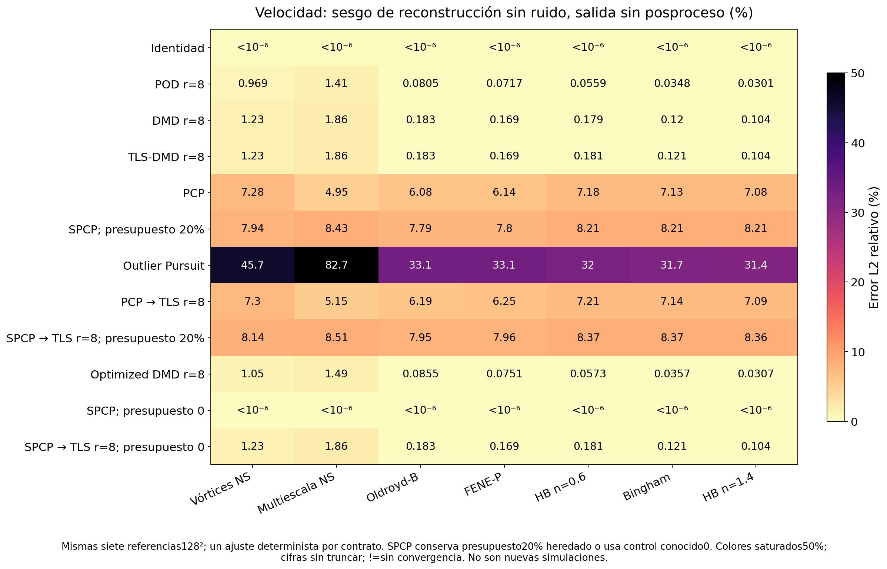
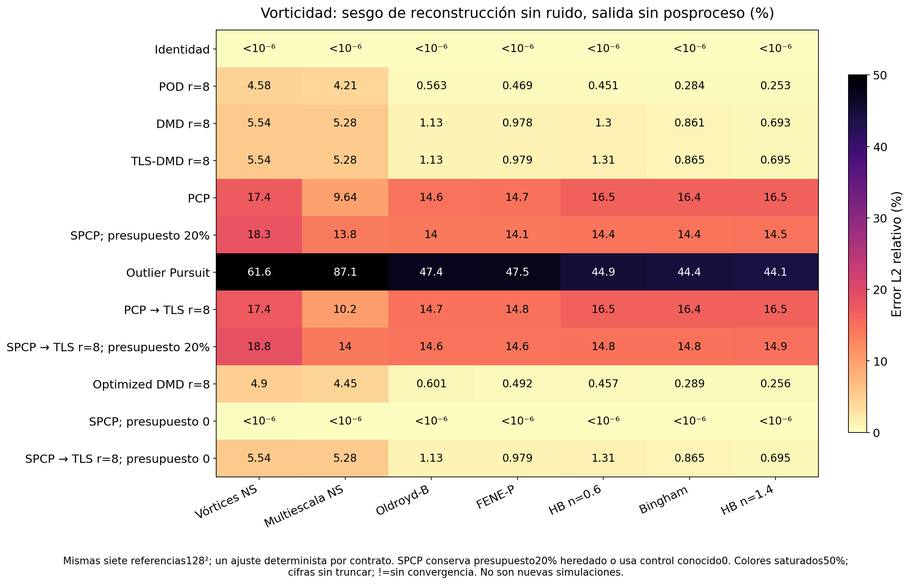
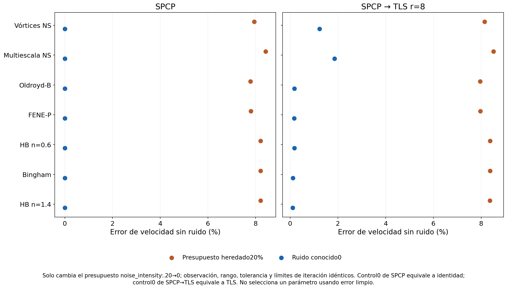

# Controles sin contaminación: representación y regularización

Estos 84 ajustes y 252 evaluaciones usan **las mismas siete trayectorias128²** que la comparación principal. La observación es copia exacta de la velocidad calculada: sin ruido aditivo y sin normalización RMS. El diseño es exploratorio posterior a observar el sesgo de Outlier Pursuit en el primer flujo con ruido; no está prerregistrado y no añade simulaciones nuevas.

- **70 ajustes:** diez modelos, siete trayectorias, parámetros idénticos al experimento20%. Para SPCP/SPCP→TLS se mantiene noise_intensity=.20; se interpreta como contrato regularizado heredado aplicado sin ruido, no como ruido observado20%.
- **14 ajustes adicionales:** SPCP y SPCP→TLS usan noise_intensity=0 conocido. Solo cambia ese presupuesto; el resto del contrato permanece igual.
- **252 evaluaciones:** cada estimación se evalúa sin posproceso, con H y con H+k≤10. No se vuelve a ajustar el modelo.
- Una ejecución por contrato: la semilla101 fija Optimized DMD. No se añaden copias por semillas de ruido inexistente, ni repeticiones de coste como muestras independientes.

## Qué separan estos controles

POD r=8 sobre datos limpios alcanza el límite de error Frobenius de una matriz de rango8, calculado directamente con SVD. Es un diagnóstico de representación y no una elección del rango para datos ruidosos; no certifica error óptimo de vorticidad. DMD añade una restricción de evolución lineal/modal y ajuste de amplitudes sobre la misma ventana, de modo que su error limpio puede superar el de POD. PCP y Outlier Pursuit seleccionan rango mediante penalización nuclear; el rango solicitado8 no se les impone. La convergencia del objetivo de separación no garantiza que toda dinámica limpia sea identificable como su componente de bajo rango.





## Papel del presupuesto de regularización

Con presupuesto0, el problema SPCP implementado tiene alpha=beta=0 y admite infinitos minimizadores L+S=M; no identifica L=M de forma única. La implementación inicia S=0 y devuelve L≈M a redondeo, eliminando penalización sin efectuar limpieza. Por esa elección de implementación, el híbrido SPCP→TLS con presupuesto0 reproduce TLS aplicado directamente. Los nonzeros de S a redondeo pueden dar sparse_fraction alta con norma ínfima; no indican contaminación real en estas observaciones exactas. Estos controles separan contracción por regularización de la restricción modal; no demuestran que presupuesto0 sea una opción adecuada con contaminación real.



## Límites físicos

Para Navier–Stokes se evalúa disipación viscosa y residual muestreado de vorticidad. Para los tres viscoplásticos se deriva viscosidad y esfuerzo de los gradientes de la velocidad candidata usando el cierre instantáneo regularizado y la misma ley material. El Frobenius simétrico pondera(xx,xy,yy) con(1,2,1). Para Oldroyd-B y FENE-P, esfuerzo polimérico y disipación total quedan nulos/no disponibles: memoria y conformation no se infieren de un estimador de velocidad. El piso limpio introducido por H+k10 se conserva en identidad+k10; no se adjudica al algoritmo ni se elimina de la evaluación.

### Estructura limpia eliminada por el prior de banda

El filtro k≤10 retiene la misma banda física en todas las referencias, pero su sesgo depende del espectro de cada flujo. En un dominio periódico, eliminar modos fuera de banda impone un piso ortogonal de error respecto al campo limpio completo. Es una pérdida de estructuras calculadas, no una prueba de error absoluto frente a Navier–Stokes continuo.

| Referencia | Piso de banda eᵤ (%) | Piso de banda eω (%) | POD r8 sin filtro eω (%) | POD r8 con banda eω (%) |
| --- | --- | --- | --- | --- |
| Vórtices NS | 0.46099 | 3.5411 | 4.5767 | 5.5574 |
| Multiescala NS | 3.068 | 10.837 | 4.2103 | 11.125 |
| Oldroyd-B | 0.16711 | 1.4476 | 0.56342 | 1.4921 |
| FENE-P | 0.13882 | 1.1896 | 0.46938 | 1.234 |
| HB n=0.6 | 0.25555 | 2.0123 | 0.45102 | 2.0222 |
| Bingham | 0.13246 | 1.0719 | 0.28421 | 1.0785 |
| HB n=1.4 | 0.082947 | 0.75611 | 0.25338 | 0.76435 |

En NS multiescala el piso de vorticidad de la banda es 10.8366%: un modelo restringido a k≤10 no puede alcanzar eω≤10% respecto a esta referencia completa. POD r8 limpio tiene eω=4.2103% sin filtro y 11.1249% con la banda. Un prior útil para eliminar ruido iid puede empeorar fidelidad sobre una observación limpia.

Incluso POD r8 sin ruido y con eᵤ≈0.969% en NS vórtices presenta residual extra muestreado de vorticidad normalizado≈1.979; TLS r8≈2.391. Conservar energía o un error integrado pequeño no garantiza dinámica fiel. Es un diagnóstico de la ecuación de vorticidad con derivadas temporales muestreadas, no del momento completo.

## Valores por referencia

| Referencia | Piso POD r8, eᵤ (%) | PCP limpio eω (%) | Outlier Pursuit limpio eᵤ (%) | TLS limpio eᵤ (%) | SPCP presupuesto20%, eᵤ (%) | SPCP presupuesto0, eᵤ (%) |
| --- | --- | --- | --- | --- | --- | --- |
| Vórtices NS | 0.96925 | 17.38 | 45.703 | 1.2288 | 7.9412 | 5.7533e-13 |
| Multiescala NS | 1.4111 | 9.643 | 82.691 | 1.8609 | 8.4269 | 5.239e-13 |
| Oldroyd-B | 0.080521 | 14.59 | 33.053 | 0.18328 | 7.7852 | 4.561e-13 |
| FENE-P | 0.071712 | 14.671 | 33.114 | 0.16884 | 7.8021 | 4.873e-13 |
| HB n=0.6 | 0.055898 | 16.51 | 32.04 | 0.18078 | 8.2143 | 3.6221e-13 |
| Bingham | 0.034798 | 16.442 | 31.69 | 0.12066 | 8.2117 | 3.4804e-13 |
| HB n=1.4 | 0.030093 | 16.497 | 31.398 | 0.10415 | 8.2116 | 2.5912e-13 |

Los valores son deterministas sobre estas referencias; no son medianas de realizaciones nuevas. `summary.csv/json` preserva convergencia, todas las variantes, máximos entre snapshots guardados, estados finales y observables materiales; `ledger.jsonl` conserva diagnósticos y series. `clean_pod_rank8_diagnostic.json` publica singular values y el límite Frobenius.

```bash
python python/scripts/run_clean_model_controls.py
```
