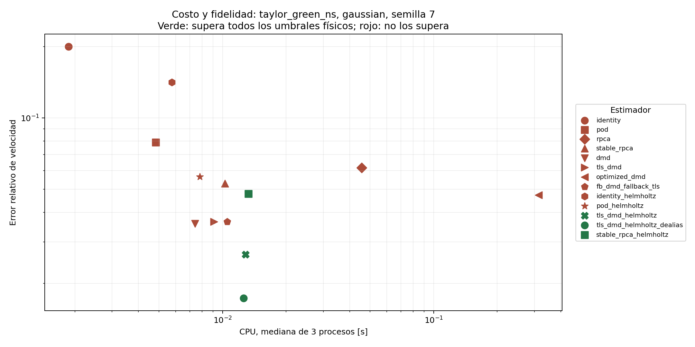

# Resultados de la ampliación ejecutada

Campaña `extended_physics_2026-10-14`: **2808 condiciones, 8424 ajustes**. 8 campos limpios, 9 ruidos, 13 configuraciones de métodos, 3 semillas y 3 repeticiones de recursos por condición.

Se registraron **0 ajustes fallidos**, **6 condiciones sin convergencia completa** y **430 condiciones que cumplen los umbrales físicos y la convergencia declarada**.

## Qué muestran los cálculos

Esta tabla selecciona, para cada caso y ruido, el menor error de velocidad mediano entre métodos que convergieron en las 3 semillas. Es una comparación descriptiva dentro del piloto, no una selección de hiperparámetros ni una prueba de superioridad universal. La última columna indica cuántas semillas cumplen además todos los umbrales físicos.

| Caso | Ruido | Menor error de velocidad | Error u | Error ω | Aceptación física |
|---|---|---|---:|---:|---:|
| taylor_green_ns | gaussian | tls_dmd_helmholtz_dealias | 1.684% | 7.143% | 3/3 |
| taylor_green_ns | sparse_impulsive | rpca | <0.001% | 0.001% | 3/3 |
| taylor_green_ns | mixed | tls_dmd_helmholtz_dealias | 1.697% | 7.463% | 3/3 |
| taylor_green_ns | spatial_correlated | tls_dmd_helmholtz_dealias | 3.126% | 5.036% | 3/3 |
| taylor_green_ns | temporal_correlated | tls_dmd_helmholtz_dealias | 6.877% | 29.209% | 0/3 |
| taylor_green_ns | column_outliers | tls_dmd_helmholtz_dealias | 1.782% | 7.417% | 3/3 |
| taylor_green_ns | student_t | tls_dmd_helmholtz_dealias | 1.706% | 7.633% | 3/3 |
| taylor_green_ns | heteroscedastic | tls_dmd_helmholtz_dealias | 1.850% | 7.740% | 3/3 |
| taylor_green_ns | sensor_drift | stable_rpca | 19.429% | 4.125% | 0/3 |
| interacting_vortices_ns | gaussian | tls_dmd_helmholtz_dealias | 3.800% | 27.128% | 0/3 |
| interacting_vortices_ns | sparse_impulsive | tls_dmd_helmholtz_dealias | 3.901% | 27.574% | 0/3 |
| interacting_vortices_ns | mixed | tls_dmd_helmholtz_dealias | 3.797% | 27.166% | 0/3 |
| interacting_vortices_ns | spatial_correlated | tls_dmd_helmholtz_dealias | 5.488% | 17.344% | 3/3 |
| interacting_vortices_ns | temporal_correlated | tls_dmd_helmholtz_dealias | 7.520% | 59.521% | 0/3 |
| interacting_vortices_ns | column_outliers | rpca | 7.140% | 17.838% | 0/3 |
| interacting_vortices_ns | student_t | tls_dmd_helmholtz_dealias | 3.869% | 27.773% | 0/3 |
| interacting_vortices_ns | heteroscedastic | tls_dmd_helmholtz_dealias | 3.834% | 27.568% | 0/3 |
| interacting_vortices_ns | sensor_drift | identity_helmholtz | 20.000% | <0.001% | 0/3 |
| decaying_turbulence_ns | gaussian | tls_dmd_helmholtz_dealias | 3.985% | 17.705% | 3/3 |
| decaying_turbulence_ns | sparse_impulsive | rpca | 2.174% | 5.805% | 3/3 |
| decaying_turbulence_ns | mixed | tls_dmd_helmholtz_dealias | 3.999% | 17.746% | 3/3 |
| decaying_turbulence_ns | spatial_correlated | tls_dmd_helmholtz_dealias | 5.754% | 10.801% | 3/3 |
| decaying_turbulence_ns | temporal_correlated | tls_dmd_helmholtz_dealias | 7.875% | 37.529% | 0/3 |
| decaying_turbulence_ns | column_outliers | rpca | 5.056% | 8.473% | 3/3 |
| decaying_turbulence_ns | student_t | tls_dmd_helmholtz_dealias | 4.018% | 17.813% | 3/3 |
| decaying_turbulence_ns | heteroscedastic | tls_dmd_helmholtz_dealias | 4.414% | 19.128% | 3/3 |
| decaying_turbulence_ns | sensor_drift | rpca | 19.968% | 3.069% | 0/3 |
| oldroyd_b_2d | gaussian | tls_dmd_helmholtz_dealias | 2.768% | 13.333% | 3/3 |
| oldroyd_b_2d | sparse_impulsive | rpca | 0.995% | 2.721% | 3/3 |
| oldroyd_b_2d | mixed | tls_dmd_helmholtz_dealias | 2.799% | 13.078% | 3/3 |
| oldroyd_b_2d | spatial_correlated | tls_dmd_helmholtz_dealias | 4.203% | 8.810% | 3/3 |
| oldroyd_b_2d | temporal_correlated | tls_dmd_helmholtz_dealias | 7.408% | 39.902% | 0/3 |
| oldroyd_b_2d | column_outliers | rpca | 4.010% | 6.436% | 3/3 |
| oldroyd_b_2d | student_t | tls_dmd_helmholtz_dealias | 2.774% | 12.769% | 3/3 |
| oldroyd_b_2d | heteroscedastic | tls_dmd_helmholtz_dealias | 2.741% | 12.751% | 3/3 |
| oldroyd_b_2d | sensor_drift | stable_rpca | 19.791% | 8.187% | 0/3 |
| fene_p_2d | gaussian | tls_dmd_helmholtz_dealias | 2.770% | 13.337% | 3/3 |
| fene_p_2d | sparse_impulsive | rpca | 0.994% | 2.720% | 3/3 |
| fene_p_2d | mixed | tls_dmd_helmholtz_dealias | 2.801% | 13.082% | 3/3 |
| fene_p_2d | spatial_correlated | tls_dmd_helmholtz_dealias | 4.204% | 8.815% | 3/3 |
| fene_p_2d | temporal_correlated | tls_dmd_helmholtz_dealias | 7.408% | 39.908% | 0/3 |
| fene_p_2d | column_outliers | rpca | 4.009% | 6.438% | 3/3 |
| fene_p_2d | student_t | tls_dmd_helmholtz_dealias | 2.777% | 12.772% | 3/3 |
| fene_p_2d | heteroscedastic | tls_dmd_helmholtz_dealias | 2.743% | 12.754% | 3/3 |
| fene_p_2d | sensor_drift | stable_rpca | 19.791% | 8.191% | 0/3 |
| hb_thinning_2d | gaussian | tls_dmd_helmholtz_dealias | 4.197% | 18.286% | 3/3 |
| hb_thinning_2d | sparse_impulsive | tls_dmd_helmholtz_dealias | 4.183% | 18.512% | 3/3 |
| hb_thinning_2d | mixed | tls_dmd_helmholtz_dealias | 4.236% | 18.728% | 3/3 |
| hb_thinning_2d | spatial_correlated | tls_dmd_helmholtz_dealias | 5.914% | 13.865% | 3/3 |
| hb_thinning_2d | temporal_correlated | tls_dmd_helmholtz_dealias | 7.712% | 40.167% | 0/3 |
| hb_thinning_2d | column_outliers | rpca | 6.085% | 13.029% | 3/3 |
| hb_thinning_2d | student_t | tls_dmd_helmholtz_dealias | 4.208% | 18.513% | 3/3 |
| hb_thinning_2d | heteroscedastic | tls_dmd_helmholtz_dealias | 4.213% | 18.594% | 3/3 |
| hb_thinning_2d | sensor_drift | rpca | 19.992% | 9.545% | 0/3 |
| bingham_2d | gaussian | tls_dmd_helmholtz_dealias | 4.010% | 18.135% | 3/3 |
| bingham_2d | sparse_impulsive | tls_dmd_helmholtz_dealias | 3.999% | 18.409% | 3/3 |
| bingham_2d | mixed | tls_dmd_helmholtz_dealias | 4.048% | 18.591% | 3/3 |
| bingham_2d | spatial_correlated | tls_dmd_helmholtz_dealias | 5.813% | 13.482% | 3/3 |
| bingham_2d | temporal_correlated | tls_dmd_helmholtz_dealias | 7.613% | 40.576% | 0/3 |
| bingham_2d | column_outliers | rpca | 5.851% | 12.486% | 3/3 |
| bingham_2d | student_t | tls_dmd_helmholtz_dealias | 4.021% | 18.405% | 3/3 |
| bingham_2d | heteroscedastic | tls_dmd_helmholtz_dealias | 4.032% | 18.494% | 3/3 |
| bingham_2d | sensor_drift | rpca | 19.962% | 8.933% | 0/3 |
| hb_thickening_2d | gaussian | tls_dmd_helmholtz_dealias | 3.810% | 18.074% | 3/3 |
| hb_thickening_2d | sparse_impulsive | tls_dmd_helmholtz_dealias | 3.804% | 18.384% | 3/3 |
| hb_thickening_2d | mixed | tls_dmd_helmholtz_dealias | 3.848% | 18.538% | 3/3 |
| hb_thickening_2d | spatial_correlated | tls_dmd_helmholtz_dealias | 5.706% | 13.174% | 3/3 |
| hb_thickening_2d | temporal_correlated | tls_dmd_helmholtz_dealias | 7.507% | 41.080% | 0/3 |
| hb_thickening_2d | column_outliers | rpca | 5.587% | 11.931% | 3/3 |
| hb_thickening_2d | student_t | tls_dmd_helmholtz_dealias | 3.822% | 18.395% | 3/3 |
| hb_thickening_2d | heteroscedastic | tls_dmd_helmholtz_dealias | 3.846% | 18.520% | 3/3 |
| hb_thickening_2d | sensor_drift | rpca | 19.947% | 8.377% | 0/3 |

Sólo **150/216 grupos caso/ruido/semilla** tienen algún estimador admisible con estos umbrales. Los otros **66** quedan registrados como ausencia de solución a la tolerancia fijada, no como métodos rápidos exitosos.

| Ruido | Condiciones que cumplen todos los criterios |
|---|---:|
| column_outliers | 39/312 |
| gaussian | 33/312 |
| heteroscedastic | 33/312 |
| mixed | 33/312 |
| sensor_drift | 0/312 |
| sparse_impulsive | 57/312 |
| spatial_correlated | 202/312 |
| student_t | 33/312 |
| temporal_correlated | 0/312 |

En Taylor–Green gaussiano, la familia DMD alcanza menor error de velocidad que PCP en este rango y presupuesto. Una mejora de velocidad por sí sola no garantiza cumplir simultáneamente los criterios físicos. La diferencia entre las columnas de velocidad, vorticidad y aceptación justifica investigar restricciones físicas, sensibilidad de rango y parámetros en validación independiente. Los conteos son descriptivos del banco; no representan probabilidades de éxito en flujos reales.

Los ruidos y presupuestos de intensidad son los declarados en provenance.json; el RMS efectivamente realizado aparece en summary.csv. La intensidad conocida sólo se usa como presupuesto experimental en la regularización estable; no se ajustan parámetros con la referencia limpia.

## Costo y fidelidad física

Se conservan CPU, tiempo de pared, RSS pico, memoria trazada, mediana e IQR de 3 ejecuciones, número de SVD, rango efectivo, iteraciones y proxy de operaciones. `cost_at_physical_tolerance.csv` encuentra el ajuste de menor CPU entre los que cumplen tolerancias; también registra los grupos sin solución admisible. `pareto_member` identifica la frontera exploratoria y `feasible_pareto_member` la frontera restringida a tolerancias físicas, dentro de cada caso/ruido/semilla.

Los perfiles estacionarios HB/Bingham son referencias temporales de rango uno y no representan estelas ni caos. Consulte los metadatos para distinguir referencias paralelas de canales y solvers bidimensionales. La evaluación de reconstrucción es dentro de muestra; ninguna cifra demuestra pronóstico, desempeño PIV real o generalización entre fluidos.

## Evidencia y límites

- [Resumen de cada condición](summary.csv).
- [Repeticiones y diagnósticos](ledger.jsonl).
- [Proveniencia, parámetros y hashes](provenance.json).
- [Variación entre semillas](quality_by_seed.csv).
- [Convergencia del solver NS](../../../docs/research/DNS_VALIDATION.md) y [reología](../../../docs/research/NON_NEWTONIAN.md).

Las métricas de masa y energía requieren densidad declarada; una reconstrucción de velocidad no estima densidad. La continuidad, divergencia y flujo se comparan tanto con cero como con el residual de la referencia. Los canales agregan comprobación de no deslizamiento y penetración. La convergencia de PCP se refiere a factibilidad primal, sin certificado de optimalidad; los fallos y no convergencias no se eliminan de los registros. El tiempo incluye instrumentación `tracemalloc` y el RSS incluye runtime y entradas; estas mediciones no se equiparan a los tiempos históricos de la tesis.

Las tolerancias son exploratorias predeclaradas. Una configuración no demuestra que una campaña se haya ejecutado; las conclusiones se limitan a las condiciones registradas y al alcance declarado por cada generador.
