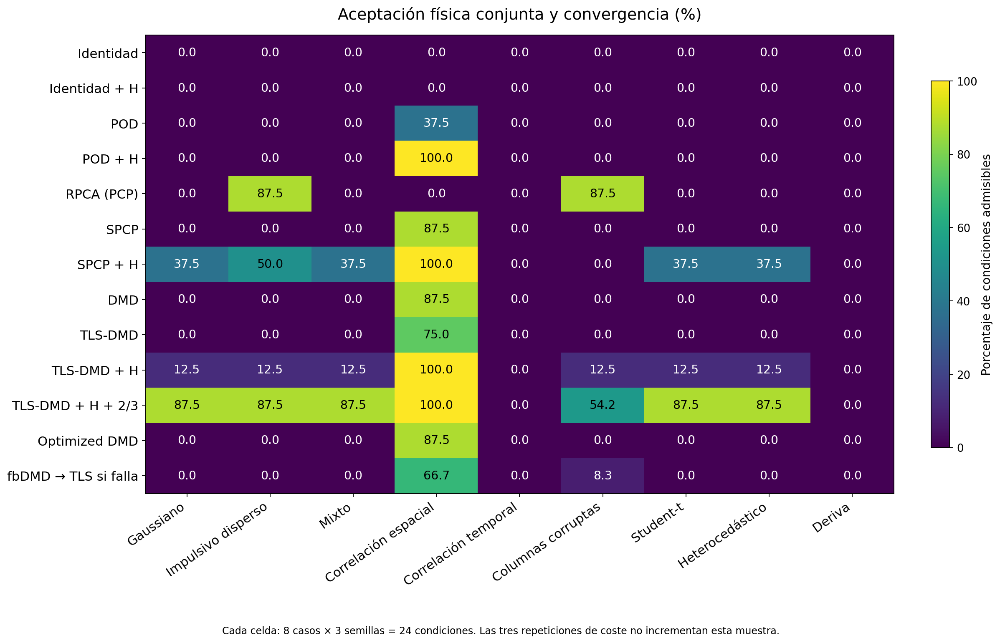
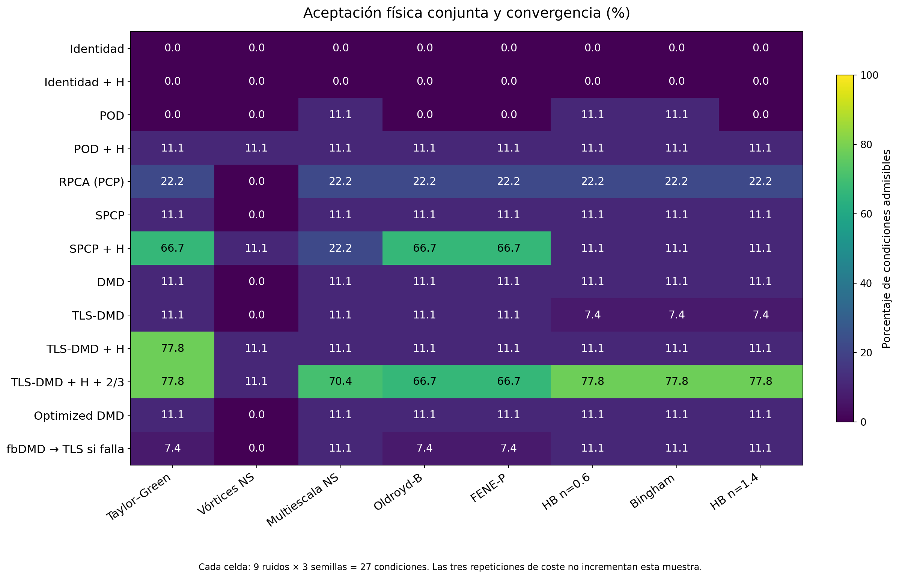
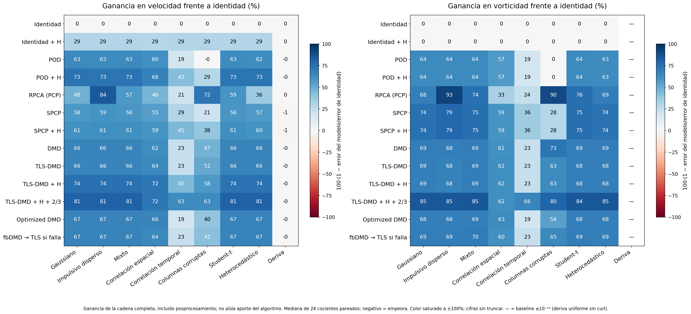
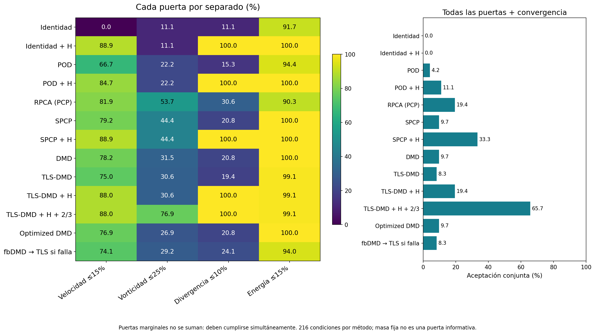
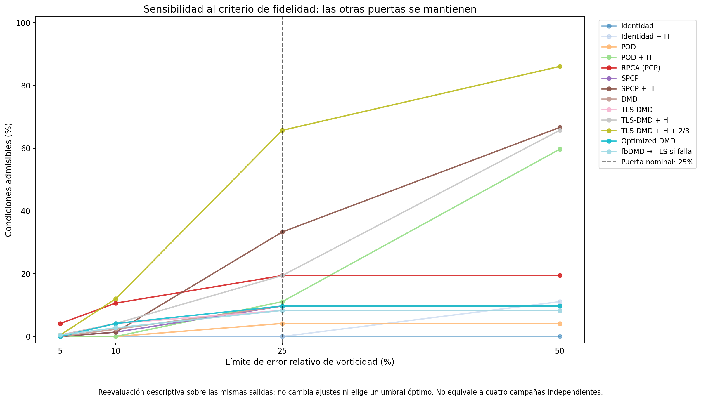
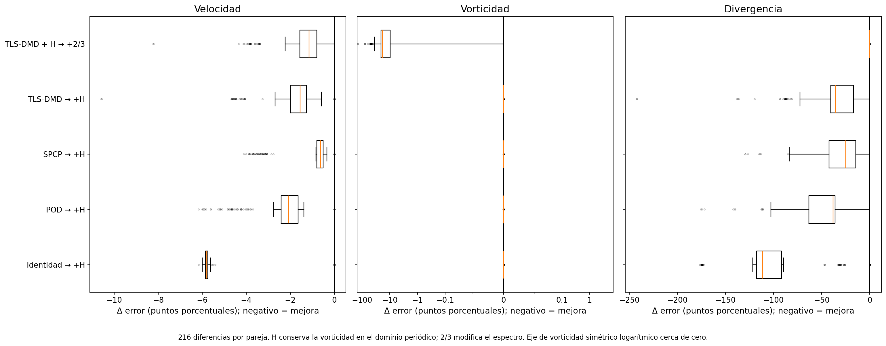
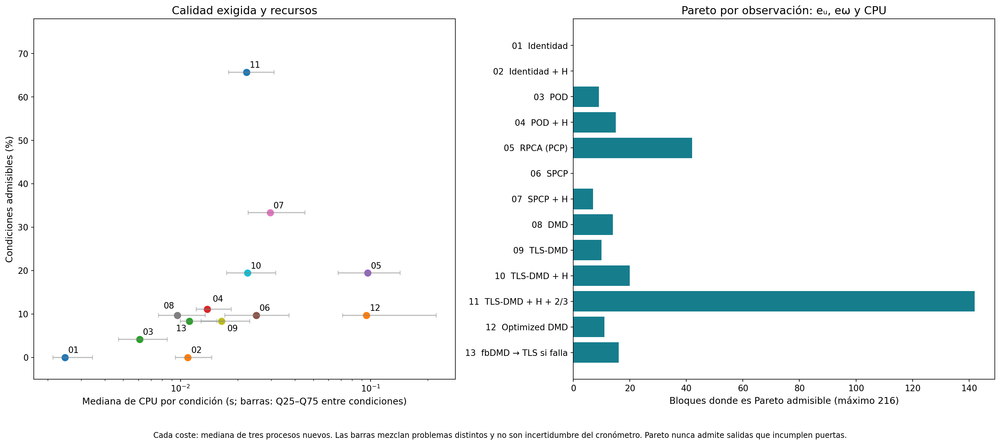
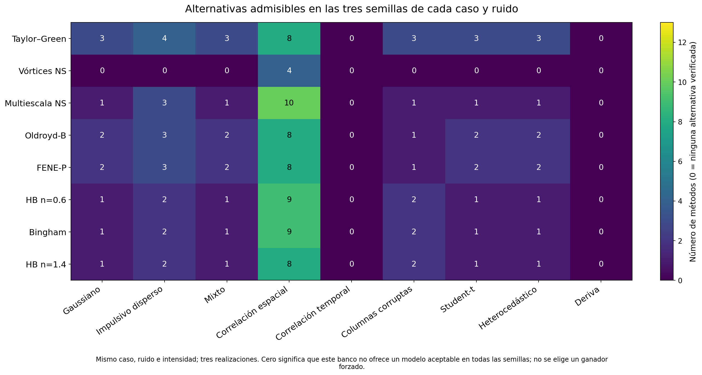
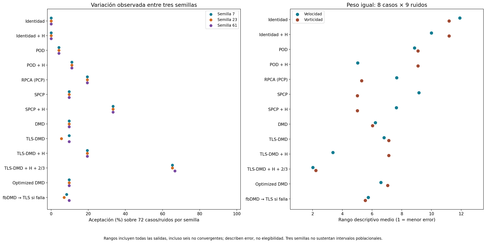

# Comparación pareada de modelos y fidelidad de reconstrucción

## Resultado central

El banco completo conserva 2 808 condiciones, 216 observaciones pareadas y 8 424 mediciones de recursos. Hay **430 salidas admisibles** al exigir simultáneamente cuatro puertas físicas y convergencia; **66/216 observaciones no tienen ningún método admisible**. La ausencia de alternativa se publica, en lugar de imponer un ganador.

TLS-DMD + H + 2/3 alcanza 142/216 aceptaciones; SPCP + H alcanza 72/216. Esta jerarquía corresponde a los casos, tamaños, rango 4, intensidad RMS 20% y ventanas de esta campaña. No demuestra superioridad universal, resolución DNS de las referencias ni pronóstico fuera de muestra.

Este banco usa mallas 24² (Taylor–Green), 48² (vórtices NS), 64² (multiescala NS) y 32² (cinco casos no newtonianos). Es una comparación exploratoria sobre referencias propias de esas mallas; el refinamiento de las campañas de mayor resolución no certifica retroactivamente estas ocho trayectorias. En ruido iid, la contaminación de gradientes cambia con N incluso cuando el RMS de velocidad es igual.

## Qué se compara y cómo leer los números

- Unidad de calidad: un caso × tipo de ruido × semilla × método. Los 31–41 snapshots de una trayectoria no se cuentan como observaciones independientes.
- Pareamiento: todos los métodos reciben la misma realización de ruido dentro de cada caso/ruido/semilla. Semillas 7, 23 y 61; nueve ruidos normalizados al mismo RMS relativo realizado de 20%.
- Recursos: tres procesos nuevos por condición; mediana, IQR y rango del tiempo de CPU, reloj, RSS y memoria Python. Tres repeticiones de coste no son tres realizaciones nuevas de ruido.
- Puertas predeclaradas: error de velocidad ≤15%, vorticidad ≤25%, divergencia extra normalizada ≤10% y energía ≤15%. Densidad fija y masa exacta son supuestos del banco; no prueban conservación dinámica.
- H designa proyección de Helmholtz periódica; 2/3 es una restricción espectral asociada a la malla. El filtro 2/3 del reconstructor no debe confundirse con eliminar aliasing de un producto no lineal del solver.
- Errores de velocidad y vorticidad se presentan separados. Los rangos macro dan peso igual a cada uno de los 72 pares caso/ruido y luego a sus tres semillas. Los costes heterogéneos no se agregan como una carga universal.
- Los rangos empatan errores que difieren ≤10⁻¹⁰ dentro del bloque; las diferencias de redondeo entre un modelo y su proyección H no crean una jerarquía artificial de vorticidad.
- No se calculan intervalos de confianza poblacionales, significancias ni bootstrap con tres semillas. Mediana, rango e IQR describen exclusivamente estas realizaciones.

## Comparación completa

| Método | Admisibles | Condiciones | Mediana eᵤ (%) | Mediana eω (%) | CPU mediana (s) |
| --- | --- | --- | --- | --- | --- |
| Identidad | 0 | 216 | 20 | 112 | 0.00247 |
| Identidad + H | 0 | 216 | 14.2 | 112 | 0.0109 |
| POD | 9 | 216 | 7.97 | 38.5 | 0.0061 |
| POD + H | 24 | 216 | 5.8 | 38.5 | 0.0138 |
| RPCA (PCP) | 42 | 216 | 9.08 | 23.4 | 0.0965 |
| SPCP | 21 | 216 | 8.69 | 26.3 | 0.025 |
| SPCP + H | 72 | 216 | 8.01 | 26.3 | 0.0296 |
| DMD | 21 | 216 | 7.13 | 33.9 | 0.00963 |
| TLS-DMD | 18 | 216 | 7.35 | 37.1 | 0.0165 |
| TLS-DMD + H | 42 | 216 | 5.44 | 37.1 | 0.0225 |
| TLS-DMD + H + 2/3 | 142 | 216 | 4.08 | 17.9 | 0.0222 |
| Optimized DMD | 21 | 216 | 6.94 | 37 | 0.0952 |
| fbDMD → TLS si falla | 18 | 216 | 7.13 | 35.9 | 0.0111 |

Las medianas de esta tabla incluyen todas las salidas, incluso las seis no convergentes identificadas abajo. Una mediana baja no implica que el método pase todas las puertas ni todas las realizaciones. Los CSV preservan la distribución y cada bloque.





## H1: la jerarquía depende del ruido

El ruido disperso favorece la separación PCP; las contaminaciones densas, dependientes o con deriva requieren comprobar el objetivo por separado. `method_noise_summary.csv` muestra 24 condiciones por celda y `paired_vs_identity.csv` conserva cada ganancia pareada, definida como 1−e_modelo/e_identidad. Una ganancia negativa se conserva: normalizar a igual RMS no iguala estructura espectral ni identificabilidad.

Las ganancias frente a identidad sin procesar atribuyen el efecto de la cadena completa (modelo + posprocesamiento). No aíslan el aporte algorítmico de DMD o RPCA. `paired_prior_control.csv` usa identidad con el mismo prior para las variantes sin H y con H. El banco histórico carece de identidad+H+2/3: sus 216 comparaciones controladas se marcan no disponibles, sin inventar ese experimento. La campaña nueva debe aportar ese control antes de atribuir a TLS una ventaja que podría explicar el filtrado.

La deriva espacialmente uniforme modifica velocidad y mantiene curl/divergencia a redondeo; dividir por su error de vorticidad ≤10⁻¹² carece de significado. Esos cocientes se marcan indefinidos (—), y se conserva la diferencia absoluta pareada. No se reportan ganancias gigantes originadas por dividir por ruido numérico.



### Resultados por ruido

- **Gaussiano:** mayor cobertura observada: TLS-DMD + H + 2/3: 21/24; SPCP + H: 9/24; TLS-DMD + H: 3/24.
- **Impulsivo disperso:** mayor cobertura observada: RPCA (PCP): 21/24; TLS-DMD + H + 2/3: 21/24; SPCP + H: 12/24.
- **Mixto:** mayor cobertura observada: TLS-DMD + H + 2/3: 21/24; SPCP + H: 9/24; TLS-DMD + H: 3/24.
- **Correlación espacial:** mayor cobertura observada: TLS-DMD + H + 2/3: 24/24; TLS-DMD + H: 24/24; POD + H: 24/24.
- **Correlación temporal:** mayor cobertura observada: TLS-DMD + H + 2/3: 0/24; SPCP: 0/24; SPCP + H: 0/24.
- **Columnas corruptas:** mayor cobertura observada: RPCA (PCP): 21/24; TLS-DMD + H + 2/3: 13/24; TLS-DMD + H: 3/24.
- **Student-t:** mayor cobertura observada: TLS-DMD + H + 2/3: 21/24; SPCP + H: 9/24; TLS-DMD + H: 3/24.
- **Heterocedástico:** mayor cobertura observada: TLS-DMD + H + 2/3: 21/24; SPCP + H: 9/24; TLS-DMD + H: 3/24.
- **Deriva:** mayor cobertura observada: Identidad: 0/24; Identidad + H: 0/24; POD + H: 0/24.

### Resultados por caso

- **Taylor–Green:** mayor cobertura observada: TLS-DMD + H + 2/3: 21/27; TLS-DMD + H: 21/27; SPCP + H: 18/27.
- **Vórtices NS:** mayor cobertura observada: TLS-DMD + H + 2/3: 3/27; SPCP + H: 3/27; TLS-DMD + H: 3/27.
- **Multiescala NS:** mayor cobertura observada: TLS-DMD + H + 2/3: 19/27; RPCA (PCP): 6/27; SPCP + H: 6/27.
- **Oldroyd-B:** mayor cobertura observada: TLS-DMD + H + 2/3: 18/27; SPCP + H: 18/27; RPCA (PCP): 6/27.
- **FENE-P:** mayor cobertura observada: TLS-DMD + H + 2/3: 18/27; SPCP + H: 18/27; RPCA (PCP): 6/27.
- **HB n=0.6:** mayor cobertura observada: TLS-DMD + H + 2/3: 21/27; RPCA (PCP): 6/27; SPCP: 3/27.
- **Bingham:** mayor cobertura observada: TLS-DMD + H + 2/3: 21/27; RPCA (PCP): 6/27; SPCP: 3/27.
- **HB n=1.4:** mayor cobertura observada: TLS-DMD + H + 2/3: 21/27; RPCA (PCP): 6/27; SPCP: 3/27.

## H2: mejorar velocidad no garantiza preservar gradientes o continuidad

En **1469/2 808 salidas**, la puerta de velocidad pasa y la puerta de vorticidad falla. Estos son eventos descriptivos sobre una malla común, no una probabilidad para otros flujos. `gate_events.csv` informa fallos marginales, únicos y conjuntos sin sumarlos como si fueran disjuntos.



### Sensibilidad a la fidelidad exigida

La puerta eω≤25% es un requisito exploratorio de esta campaña, no una ley física. `tolerance_sensitivity.csv` reevalúa eω≤5%, 10%, 25% y 50%, manteniendo las puertas nominales de velocidad, divergencia, energía y convergencia. Se muestran todos los valores del pequeño grid sin elegir el que favorece a un algoritmo; son las mismas salidas, no cuatro ensayos independientes.

La conclusión cambia al exigir mayor fidelidad: con eω≤5%, RPCA acepta 9/216 y TLS-DMD+H+2/3 solo 1/216; con eω≤10% son 23/216 y 26/216; con la puerta nominal 25%, 42/216 y 142/216. Por eso la cobertura al 25% no basta para afirmar superioridad bajo una exigencia del 5%.



La aceptación no impone una puerta sobre el residual PDE. `admissible_pde_audit.csv` conserva los residuales extra de la ecuación de vorticidad para los tres casos NS donde se aplican. Un residual normalizado mayor que uno significa perturbación comparable o mayor que la escala de evolución definida por la referencia, pero no es una tolerancia predeclarada de exactitud. Este operador usa snapshots y derivadas temporales de segundo orden. No es una evaluación del residual de momento completo ni de la ecuación constitutiva de los otros cinco casos. Cumplir las cuatro puertas no certifica Navier–Stokes ni garantiza dinámica correcta.

De las 150 salidas NS que pasan las cuatro puertas y convergen, 147 presentan residual extra de la ecuación de vorticidad normalizado mayor que uno. El denominador representa una escala de evolución física; esta alerta exige revisar la dinámica y la sensibilidad temporal antes de presentar esas reconstrucciones como físicamente fieles.

## Ablaciones: cuánto aportan H y 2/3

Se compara cada posprocesamiento con su algoritmo idéntico sin ese paso, manteniendo observación, rango y semilla. H elimina la componente de gradiente pero conserva curl sobre el dominio periódico; por eso una mejora en divergencia no debe atribuirse a recuperación de vorticidad. El CSV de ablaciones publica 216 diferencias por pareja, aceptaciones rescatadas y perdidas y pruebas de igualdad de eω a 10⁻¹⁰.

| Antes | Después | Aceptadas antes | Después | Rescatadas | Perdidas | eω igual (216) |
| --- | --- | --- | --- | --- | --- | --- |
| Identidad | Identidad + H | 0 | 0 | 0 | 0 | 216 |
| POD | POD + H | 9 | 24 | 15 | 0 | 216 |
| SPCP | SPCP + H | 21 | 72 | 51 | 0 | 216 |
| TLS-DMD | TLS-DMD + H | 18 | 42 | 24 | 0 | 216 |
| TLS-DMD + H | TLS-DMD + H + 2/3 | 42 | 142 | 100 | 0 | 24 |



## H3: coste al nivel de fidelidad requerido

Pareto se calcula dentro de cada observación y únicamente con candidatos que cumplen todas las puertas y convergen. Se publican dos fronteras: eᵤ/eω/CPU y eᵤ/eω/CPU/RSS. RSS es pico absoluto del proceso, incluye intérprete y datos; FLOPs es una aproximación de operaciones dominantes y excluye varios costes. Identidad es barata y falla todas las observaciones, por lo que no pertenece a ninguna frontera admisible. La fracción de bloques donde un modelo está en Pareto informa cobertura, no un premio universal para su coste medio.



`conditions.csv` distingue IQR dentro de las tres repeticiones de cada condición de la dispersión entre problemas. El gráfico de CPU usa barras Q25–Q75 entre las medianas de 216 condiciones; no son error del reloj ni intervalos de confianza. `macro_descriptive_ranks.csv` conserva por separado orden por eᵤ, orden por eω y cobertura física; no combina objetivos con pesos arbitrarios.

## H4: dependencia del caso físico

Las ocho referencias no constituyen un ensayo controlado de reología: difieren malla, horizonte, parámetros y estado inicial. Sus diferencias de aceptación son asociaciones con el caso, no efectos causales atribuibles solo a elasticidad, cedencia o índice n. La prueba de transferibilidad debe repetir un protocolo de observación común sobre referencias de fidelidad independiente, y evaluar tensores y esfuerzos además de velocidad. Este análisis compara reconstrucción de velocidad; no reconstruye C ni τ y no convierte eᵤ bajo en una prueba de precisión constitutiva.



## Variabilidad y fragilidad numérica



Las **seis no convergencias** de Optimized DMD se conservan en `nonconvergence.csv`. No se sustituyen sus errores por éxitos ni se eliminan del denominador. La ruta fbDMD→TLS emplea respaldo en **23/216 condiciones**; `fallbacks.csv` conserva motivo y método efectivo. Solo las condiciones sin respaldo prueban una realización de fbDMD puro. Comparar la ruta completa con TLS incluye coste del intento fallido; no equivale a otro algoritmo independiente.

## Alcance y siguientes experimentos decisivos

1. Separar calidad de referencia y de reconstrucción: antes de juzgar un denoiser, contrastar malla/tiempo, PDE, balances y variables constitutivas de su referencia.
2. Repetir una selección fijada antes de mirar la referencia limpia, sobre mallas grandes, banda física y ruido comparable entre resoluciones; 2/3 cambia con N y no es una banda física constante.
3. Usar nuevas trayectorias y semillas para evaluar selección sin reutilizar los 216 bloques como validación independiente; mantener un grupo sin método admisible.
4. Separar reconstrucción de la ventana observada de predicción cronológica, y evaluar desplazamiento de fase, amplitud y espectro fuera de muestra.

## Artefactos reproducibles

Todos los CSV tienen compañero JSON. `provenance.json` guarda SHA-256 del ledger, resumen, manifiestos y configuración de origen, del script y de las tablas/figuras. `completion.json` verifica cardinalidades, las seis no convergencias y las tres repeticiones. Reproducción:

```bash
python python/scripts/analyze_paired_model_comparison.py
```

La reproducibilidad de estas tablas no requiere volver a ejecutar 8 424 ajustes; usa el ledger completo publicado.
