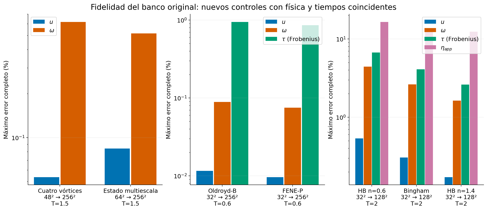
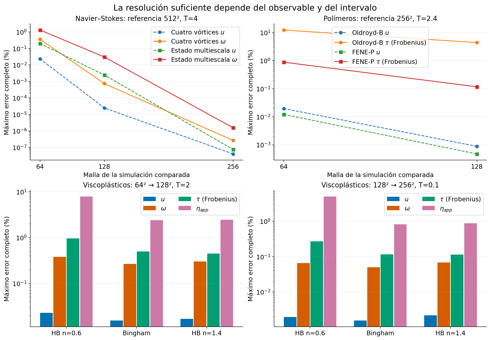
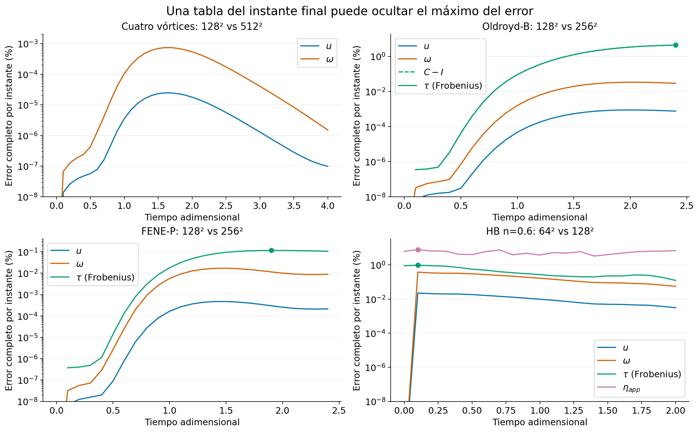
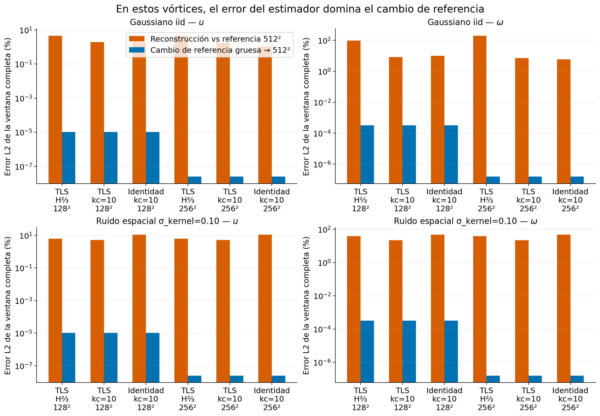
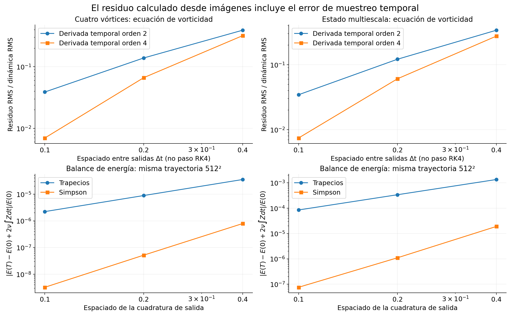
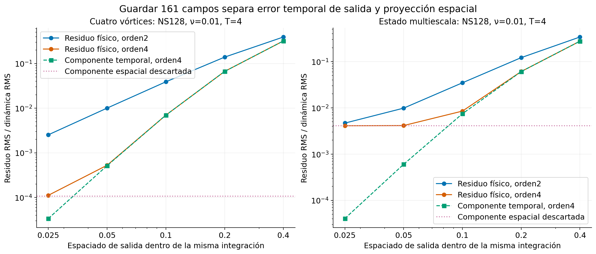
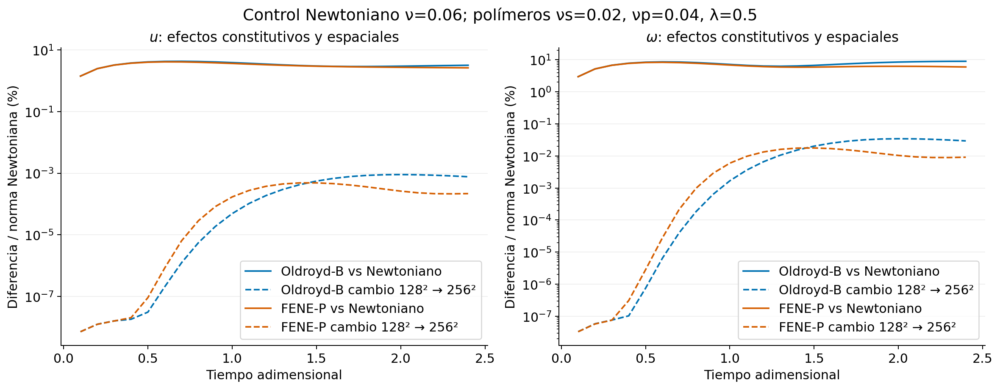

# Fidelidad de referencias y comparación de reconstrucciones

Este análisis separa tres preguntas: qué sistema físico se integra, cuánto cambia la referencia al refinar y cuánto error añade el estimador. El número de nodos no responde por sí solo a ninguna de ellas.

## Resultado que afecta directamente la comparación de modelos

El banco visual de mallas grandes utiliza condiciones distintas del banco original. Para evitar transferir indebidamente su convergencia, se ejecutaron nuevos controles que copian exactamente los parámetros físicos, condición inicial y tiempos guardados de `extended_physics_2026-10-14`. Taylor–Green se contrasta con su solución analítica; las demás referencias son integraciones nuevas del mismo solver en mallas mayores.

| Caso original | Malla → referencia | T | Error máximo u (%) | Error máximo ω (%) | Error máximo τ (%) | Error máximo η (%) |
| --- | --- | ---: | ---: | ---: | ---: | ---: |
| Taylor–Green | 24² → solución analítica | 1.5 | 7.8082e-14 | 1.7251e-13 | — | — |
| Cuatro vórtices | 48² → 256² | 1.5 | 0.053693 | 0.61982 | — | — |
| Estado multiescala | 64² → 256² | 1.5 | 0.084185 | 0.51766 | — | — |
| Oldroyd-B | 32² → 256² | 0.6 | 0.011577 | 0.089205 | 0.94917 | — |
| FENE-P | 32² → 256² | 0.6 | 0.0096484 | 0.07525 | 0.85987 | — |
| HB n=0.6 | 32² → 128² | 2 | 0.53677 | 4.4238 | 6.7231 | 16.535 |
| Bingham | 32² → 128² | 2 | 0.30683 | 2.6302 | 4.1003 | 13.02 |
| HB n=1.4 | 32² → 128² | 2 | 0.17198 | 1.6342 | 2.6152 | 12.426 |

Se completaron **18 integraciones nuevas** de las 18 configuraciones propuestas. Su costo se declara en `matched_integrations.json`. No hubo controles omitidos.

Los valores son máximos entre los instantes guardados, sobre el campo completo prolongado por Fourier. Las normas de τ usan Frobenius: para los tres componentes independientes viscoplásticos se pondera `xx² + 2xy² + yy²`. El tensor conformacional se evalúa como `C` y como `C−I`; la identidad puede ocultar un error importante en deformación. A t=0, el esfuerzo y `C−I` son cero: su error relativo es indefinido y se guarda como `null`, sin declararlo exacto.

## Qué aporta y qué no aporta la referencia grande

Las campañas visuales conservan las comparaciones 64/128/256 frente a 512 (NS, ν=0.01, U_rms=0.8, T=4), 64/128 frente a 256 (Oldroyd-B/FENE-P, U_rms=0.8, T=2.4), y viscoplásticos 64 frente a 128 durante T=2, más controles 128 frente a 256 sólo entre t=0 y 0.1. Cada conjunto tiene parámetros y denominadores propios. Ningún control de horizonte corto valida automáticamente el intervalo largo.

En el banco visual, Oldroyd-B 128 tiene máximo error de velocidad ≈0.00089%, pero de esfuerzo ≈4.38% frente a 256. El control temporal está varios órdenes por debajo; la limitación es principalmente espacial para esos observables. La cola de esfuerzo de 256 alcanza ≈1.157e-4 bajo la definición declarada; no se afirma convergencia absoluta del tensor. En HB adelgazante 128 frente a 256, el error de η alcanza ≈5.02% aunque u≈0.00196%; esta evidencia sólo cubre t≤0.1.

## Presupuesto de error del estimador

Se usa una comparación verificable de tres campos en la misma malla 512 y los mismos 41 tiempos: `r` (referencia gruesa prolongada), `f` (referencia 512) y `c` (reconstrucción prolongada). Para `a=||c−r||/||r||`, `q=||r||/||f||` y `δ=||r−f||/||f||`, la desigualdad triangular da **`|a q−δ| ≤ ||c−f||/||f|| ≤ a q+δ`**. Los CSV guardan ambas cotas y el valor calculado directamente. La afirmación se refiere a la referencia numérica f; no es una cota contra la solución exacta desconocida.

En los vórtices suaves con semilla de ruido 7, estos intervalos son extremadamente estrechos comparados con el error de reconstrucción: el cambio de referencia explica una fracción mínima de los errores del estimador, especialmente de la vorticidad. La identidad filtrada se conserva como control, de modo que el beneficio de limitar banda no se atribuye automáticamente a TLS-DMD. `kc=10` fue una hipótesis exploratoria posterior a los 60 fallos iniciales y no constituye validación ciega con datos independientes.

Además de los errores individuales se comprueba si la ordenación entre dos estimadores podría cambiar sólo por sustituir la referencia gruesa por 512: la condición suficiente es `(a_alto−a_bajo) q > 2δ`. `pairwise_reference_rank_stability.csv` registra la diferencia, el margen y el orden calculado directamente para cada pareja. Esto certifica estabilidad de esa comparación contra 512 en esos campos, no superioridad universal ni una cota a la verdad continua. Se conserva el resultado cuando la identidad con el mismo filtro supera a TLS-DMD: la resolución de la referencia no se usa como excusa para invertir esa conclusión.

## Residuos físicos: integración y muestreo son cosas distintas

Se recomputó la ecuación de vorticidad `ω_t+u·∇ω−νΔω=0` en NS 512 con derivadas centrales de orden 2 y 4, usando separaciones de salida 0.1/0.2/0.4 sobre exactamente los mismos siete centros t=0.8,1.2,…,3.2. Se guarda el residuo RMS en unidades adimensionales de ω/tiempo y dividido por la dinámica RMS. La escala se define en el JSON; no se confunde con el paso adaptativo interno RK4, que es mucho menor.

El balance `E−E0+2ν∫Zdt` se integra con trapecios y Simpson sobre los mismos campos guardados. Que cambie al variar el operador de salida demuestra que el valor incorpora error de cuadratura/muestreo; no permite deducir por sí solo el error del solver. El balance viscoplástico usa integral acumulada en etapas RK4 y cuadratura constitutiva con padding; es una comprobación de coherencia discreta diferente, que puede ser pequeña aunque η esté mal resuelta.

Dos controles adicionales en 128² guardan 161 campos cada 0.025, con el mismo flujo, ν, amplitud, semilla y horizonte que los experimentos visuales. Al usar todos los campos o sólo uno de cada cuatro se cambia únicamente la cadencia del diagnóstico dentro de una única integración. El JSON separa residuo temporal respecto a la dinámica proyectada de la parte del RHS físico descartada por el corte de Fourier. Esa descomposición es coherencia discreta; no certifica por sí sola la solución continua.

La comparación a los 41 tiempos comunes registra por separado el cambio de dt nominal (primario 128 a 0.005 frente al control 128 a 0.00125) y la diferencia de campo 128 frente a 512. Los controles 128 no reemplazan la validación espacial 512. Sus dos integraciones se cuentan aparte de las 18 referencias coincidentes del banco original.

## Interpretación de modelos físicos

El solver newtoniano integra Navier–Stokes incompresible 2D en un toro periódico mediante vorticidad, Fourier, corte estricto 2/3 y RK4 adaptado a CFL y difusión. No incluye paredes, cilindro ni cierre turbulento. Taylor–Green valida signos, difusión y orden temporal de un modo; no somete a prueba todo el aliasing de interacciones no lineales.

Oldroyd-B/FENE-P integran conjuntamente velocidad y conformación 3×3 en flujo plano. El esfuerzo acopla al momento mediante su divergencia; se exige conformación definida positiva y, en FENE-P, trC<L². Las etapas inválidas se rechazan: no se recorta C para esconder el fallo. La parte racional FENE-P no obtiene desaliasado exacto sólo por el corte cuadrático. Los residuos constitutivos de imágenes incluyen diferenciación temporal y proyección espacial.

Los estimadores de la comparación reconstruyen velocidad. C, τ y η en la matriz de fidelidad son observables auxiliares de la simulación, no campos que todos los algoritmos hayan reconstruido. En viscoelasticidad, el esfuerzo depende de la conformación y de su historia; no se deduce de una imagen de velocidad. La ley viscoplástica permitiría derivar esfuerzo o viscosidad desde una velocidad reconstruida si se asumen parámetros materiales conocidos, pero esa evaluación debe implementarse y declararse por separado.

Bingham/Herschel–Bulkley integran momento con divergencia del esfuerzo variable `τ=2η_app D`. La regularización Papanastasiou tiene viscosidad finita a corte cero; no produce regiones rígidas exactamente sin cedencia. Variar m o ε cambia el modelo regularizado; variar padding prueba cuadratura no polinómica; variar malla prueba resolución. El indicador `γdot>umbral` se declara aproximación dependiente de un umbral, no frontera exacta de cedencia.

El control Newtoniano ν=0.06 para polímeros coincide con ν_s+ν_p en el límite de corte cero y conserva velocidad inicial y tiempos. Las curvas de contraste constitutivo no son errores de reconstrucción. En los viscoplásticos visuales se igualó η_app=0.04 en una sola tasa de corte declarada; eso no iguala toda la ley ni proporciona un Reynolds universal equivalente.

El LBM D2Q9-BGK legado con cilindro usa transporte transversal periódico, entrada de equilibrio, salida por copia y rebote en el obstáculo. Es débilmente compresible en unidades de retícula, con ν=(τ_relajación−0.5)/3. Su referencia limpia conserva ρ, u, v y máscara; con ρ variable el balance de masa tiene contenido, pero debe incluir flujo por las fronteras abiertas. No hay convergencia de esa estela demostrada por los experimentos periódicos. La rapidez escalar no determina el vector velocidad, vorticidad, continuidad ni esfuerzo y no permite recuperar esas magnitudes de manera única.

## Unidades, tolerancias y procedencia

`evidence_ranges.csv` registra mínimos, máximos, RMS y percentiles 5/50/95 de los campos físicos. Las simulaciones periódicas son adimensionales: velocidad escala U, vorticidad/tasa de corte U/L, viscosidad ρ_ref U L y esfuerzo ρ_ref U²; sin fijar U, L y ρ_ref físicos no se inventan unidades SI. Con ρ=1 constante y dominio fijo, masa total=área por construcción; no demuestra que una reconstrucción de velocidad conserve materia localmente. Esa pregunta requiere divergencia y flujos admisibles, además de ρ reconstruida cuando corresponda.

`tolerance_sensitivity.csv` muestra si la diferencia numérica cae debajo de 1%, 5% y 10% para cada observable e intervalo. Son niveles de comparación condicionados; no semáforos universales de certeza ni cotas al continuo. Los errores de referencia deben ser menores que la diferencia entre estimadores que se pretenda interpretar; si la diferencia de modelos es comparable al cambio por refinamiento, una ordenación fina no queda respaldada sólo por esos datos.

Los hashes de todas las fuentes científicas permanecen iguales a los de las campañas de origen. Se verificaron los SHA-256 de archivos NS/VE y los digest canónicos de viscoplasticidad. Los controles nuevos identifican el manifiesto y el NPZ antiguo exacto que copian, configuración completa, pasos internos, CPU y hash del nuevo archivo. Un cambio de hash de un programa de figuras histórico no se confunde con un cambio del solver.

Reproducción: `python python/scripts/analyze_reference_fidelity.py`. La primera ejecución genera los controles coincidentes; ejecuciones posteriores reutilizan datos sólo con configuración/fuentes/hashes iguales. `--skip-matched-integrations` exige controles ya disponibles y repite el análisis. Los NPZ completos se regeneran localmente; los JSON/CSV/figuras permiten inspeccionar el resultado publicado. No se interpolan nuevas trayectorias para simular refinamiento.

## Archivos calculados

- `summary.json`: matriz de credibilidad, cotas de error, residuos y controles analíticos.
- `credibility_matrix.csv`: errores máximos/finales/ventana, observable, mallas e intervalo.
- `triangle_bounds.csv`: cotas discretas y cálculo directo de error frente a 512.
- `pairwise_reference_rank_stability.csv`: ordenación de estimadores que queda separada de la incertidumbre por cambiar a la referencia 512.
- `residual_sampling.csv`, `energy_sampling.csv`: sensibilidad de diagnóstico al muestreo.
- `evidence_ranges.csv`, `tolerance_sensitivity.csv`: magnitudes y niveles condicionados.
- `matched_integrations.json`: nuevas integraciones con física original y costo registrado.
- `source_verification.json`: fuentes/archivos verificados; `provenance.json`: entradas de este análisis.
